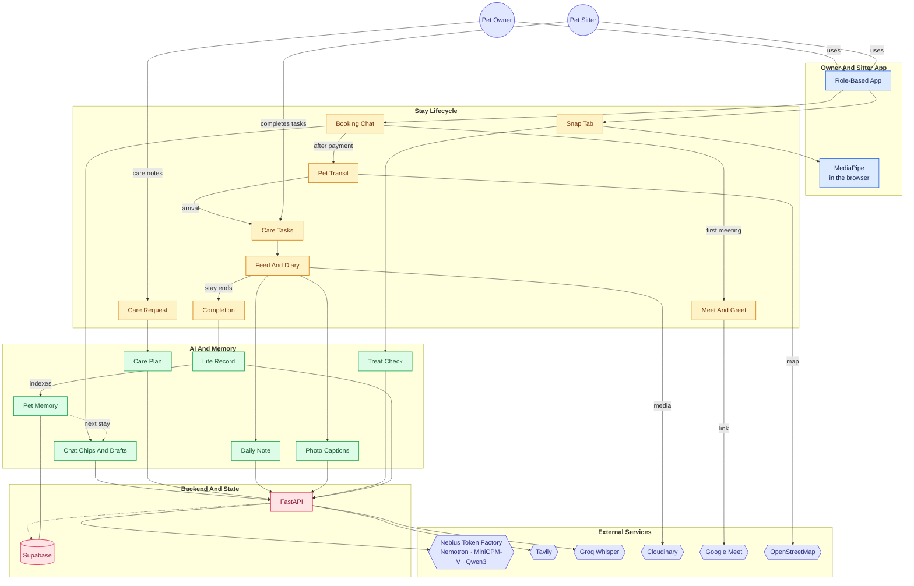

<div align="center">


# Goldito

**Leave your pet, keep your peace of mind.**
The whole stay, from the first message to the ride home, in one app for **dogs and cats**.
An AI agent built on **NVIDIA Nemotron** answers, plans, checks, and writes, so the sitter can just care.

[](https://goldito-petcare.vercel.app)
[](docs/hackathon/README.md)
[](#nvidia-nemotron-on-nebius-token-factory)
[](#nvidia-nemotron-on-nebius-token-factory)
[](#tavily-live-answers-from-trusted-sites)
[](LICENSE)

[Try it](#try-it-in-60-seconds) · [Built with](#built-with) · [How it works](#how-goldito-works) · [Agent](#the-goldito-agent) · [Nemotron](#nvidia-nemotron-on-nebius-token-factory) · [Tavily](#tavily-live-answers-from-trusted-sites) · [Feedback](#feedback-on-token-factory-and-the-models) · [Run it](#run-it-yourself)

</div>

> **Why we built this.** After dozens of stays as pet sitters, many with the same dogs and cats, we kept seeing the same thing: apps connect owners and sitters, and take a cut of every booking, but the stay itself (replies, house rules, daily notes) is still typed by hand, and a lot of it happens outside the app.
>
> **Why AI.** In our experience, owners who find typing hard (often seniors) leave their pet's profile half empty, and sitters spend their time writing instead of caring. Goldito's AI does the typing; people approve.

---

## Try it in 60 seconds

> [!TIP]
> No setup: open **[goldito-petcare.vercel.app](https://goldito-petcare.vercel.app)**, tap **Try the demo**, then **Robert, the owner** or **Chloe, the sitter**. No sign-up and no password. The demo people and pets are fictional.

1. On a computer the app runs inside a phone frame: **click = tap, drag or scroll = swipe**. Sample photos are built in, so no camera is needed, and a demo trip can **simulate the drive**, so no GPS is needed either.
2. To watch both sides of one stay, open **[the split view](https://goldito-petcare.vercel.app/?view=split)** (a window at least 900 px wide) and log in as Robert on one phone and Chloe on the other.
3. Payment is a demo: no card is asked for.

> [!NOTE]
> The backend runs on a free plan. The first request after a quiet spell can take 30 to 50 seconds while it wakes up; a job pings it every 10 minutes to keep that rare.

**Demo video:** _coming_ <!-- TODO(submission): the YouTube link (under 3 minutes, public, English voice-over on Token Factory and Nemotron). -->

---

## Built with

| | What it does in Goldito |
| :--- | :--- |
| **NVIDIA Nemotron 3** (Nano · Super · Ultra) | Every chat reply draft, care checklist, daily note, Life Record, and treat-safety verdict |
| **Nebius Token Factory** | The only AI runtime: Nemotron, MiniCPM-V 4.5 (vision), and Qwen3 Embedding 8B (RAG) behind one OpenAI-compatible API, called from the backend only |
| **Tavily** | Live search of trusted vet and government sites at runtime: the treat check and each breed's care needs |
| **Supabase** | Postgres with row-level security, Auth, Realtime (chat, notifications, live trips), and pgvector for RAG |
| **Expo** (React Native for Web) | One app for owners and sitters, shown in a phone frame on desktop · hosted on **Vercel** |
| **FastAPI** (Python 3.12) | AI endpoints, media signing, Google Meet links · Docker on **Render** |
| **Cloudinary** | Photo and video upload, compression, and delivery |
| **Groq Whisper** | Speech to text for voice sign-up (Token Factory has no speech model) |
| **MediaPipe** (in the browser) | Finds each pet in a photo for the mood meter and cuts it out for stickers |
| **Google Calendar / Meet** · **OpenStreetMap** | Video Meet & Greet links · trip map, address lookup, and a park to meet at |

---

## What changes

| For owners | For sitters |
| :--- | :--- |
| **Never need to ask.** Your pet's status (trip updates, photos, a daily note) arrives on its own, so you can relax. | **Just care, snap, and tap.** Replies, notes, and checklists are drafted for you; nothing in the house rules gets missed; you spend your time on the pet. |
| **A profile that gets filled in.** A photo, a few spoken sentences, and one big question per screen help even first-time and senior owners describe their pet. | **No more digging through old messages** for the medication time or the "don't knock" rule. It is on the checklist. |

## The five stages and what the AI does in each

| Stage | What the AI does | Model |
| :--- | :--- | :--- |
| **① Inquiry** (in one chat) | Suggests reply chips and drafts each message **in the sitter's own voice**, from the sitter's calendar, a server-side quote, house policy, and the pet's Life Record. A person always taps Send | Nemotron 3 Super + Qwen3 Embedding |
| **② Meet & Greet** | Turns the owner's care note into a timed **mission checklist** and Heads-up cards; notices the sitter's "yes" and brings up the Meet & Greet card | Nemotron 3 Super · Nano |
| **③ Booking** | Stays out of the way on purpose: quotes, consents, and the timed unlock come from fixed rules, never from the model | (none) |
| **④ Care & Pet Transit** | Suggests the day's chips, writes the **daily note**, captions and sorts photos into an album | MiniCPM-V 4.5 → Nemotron 3 Super |
| **⑤ Completion** | Writes the pet's **Life Record** and remembers it for the next stay, even with a new sitter | Nemotron 3 Super + Qwen3 Embedding |

**Around the stay.** Owners sign up by **photo and voice** (breed guess, profile facts, breed needs from Tavily). The **Snap** tab checks a treat label for allergens with **Nemotron 3 Ultra and Tavily**, reads a pet's mood, and turns the pet into stickers for the diary. Between stays, Goldito keeps the pet's story: an **8-bit pet room** on Home, a photo **album**, a **diary** of every stay, a **Life Record** that follows the pet to any sitter, **favorite sitters**, and **reviews both ways**.

---

## How Goldito works

```
 ① Inquiry ──> ② Meet & Greet ──> ③ Booking ──> ④ Care & Pet Transit ──> ⑤ Completion
 one chat;       care request       consents,      live trip · 5-second      home safe · reviews ·
 AI drafts in →  checklist ·      final quote,     check · AI daily note     Pet Life Record → RAG
 your voice      meet first       demo payment                                        │
      ▲                                                                               │
      └──────────────── the next stay starts with everything Goldito learned ─────────┘
```

Tap a stage to expand it.

<details>
<summary><b>① Inquiry: one chat per owner and sitter, with AI drafts in your own voice</b></summary>

- The owner searches sitters by dates, times, pets, and distance from home (1 to 100 km), opens a profile, and taps **Start chat**. The chat opens with a stay card (dates, times, pets) and a hello. That chat carries the whole stay: quote, Meet & Greet, agreement, payment, trips, photos, the daily note, and the reviews. The same owner and sitter always come back to the same chat.
- **The AI suggests, a person sends.** For the message the other side just wrote, Nemotron 3 Super offers two or three reply chips for *my* side. Tapping one drafts a short message in my voice (a sitter's voice is learned from their own anonymized past replies) that I can edit before I tap **Send**. When the next step is clear (send a quote, request a Meet & Greet, pay), the AI can point at one action chip, but only from the list of steps the code says are possible right now.
- **The model never writes a price or a date.** The sitter's calendar, rates, and quote (with **holiday** and **multi-pet** rates) come from the database. A draft whose numbers do not match is rewritten once, and otherwise falls back to the chip's own words. The facts also include the sitter's policy, the pet's profile and allergies, and the pet's **Life Record** (RAG on pgvector).

</details>

<details>
<summary><b>② Meet & Greet: the care request becomes a checklist, and first-time pairs meet</b></summary>

- The owner writes a **care & medication request** like a note, or taps Quick add chips: *"8 AM: 1 cup of kibble · 2 PM: skin pill in a treat · No knocking, text me · Keep other dogs away on walks."* Nemotron 3 Super turns it into timed tasks and **Heads-up** cards; the owner reviews them before saving. While a stay is on, changes go through a request the sitter approves.
- When the sitter's own words say yes (Nemotron 3 Nano reads them), the chat brings up the **Meet & Greet** card and the dates are held for this owner. First-time pairs meet **in person** (Goldito suggests a park near the owner's home from OpenStreetMap) or **online**, where the backend creates a **Google Meet** link and calendar invite. Either side can ask to skip; both must agree. Repeat clients skip this step.
- No meeting time within 2 days? Both are asked to set one, skip it, or decline; after 3 more quiet days the request is cancelled and the dates are released.

</details>

<details>
<summary><b>③ Booking: agreement, final quote, consents, payment, and secrets that unlock on time</b></summary>

- After meeting, the owner taps **I'd like to book** (with the checklist, pets, times, and price in view) and the sitter taps **I accept**, in either order. Either side can still say no, with a reason chip.
- The sitter sends the **final quote** with one tap; the server calculates it. The owner confirms it, signs the **consent forms** (Canada-first: 24-hour emergency vet authorization, lockbox / buzzer / fob use, sharing space with other pets, safe-return rules), and **pays (demo)**.
- **Timed unlock:** for boarding, the sitter's address, visitor parking, and a packing list appear right after payment. Entry info for the owner's home (lockbox code, buzzer) **unlocks for the sitter only 2 hours before the visit**, and the owner is told when it opens.

</details>

<details>
<summary><b>④ Care & Pet Transit: live trips, 5-second checks, AI daily notes</b></summary>

- **Uber-style trips, inside the chat.** Drop-off and pick-up are agreed as one pair. Whoever drives taps **Start trip** (after a clear location prompt); the chat shows *on the way*, *N min away*, and *arrived*, and the other side gets a live map and ETA. On arrival the owner gets the sitter's place card (visitor parking, lobby notes) and the sitter gets the entry-info card. Anyone can **start without sharing**: the other side then sees the meeting place with **Open in Google Maps**. On the web the traveller's screen has to stay on (browsers pause location in the background).
- **Care, snap, tap.** The sitter ticks timed tasks (the pill, with a photo), taps meal, walk, potty, or nap on the pet's **8-bit room**, and sends quick check-ins. The owner sees each update live, and their 8-bit pet on Home reflects the day. **Ask for a photo** sends the sitter a request that their next photo answers.
- **5-second check:** in the evening Goldito suggests chips from the day's check-ins and from up to two photos (MiniCPM-V 4.5 reads them): Meal · Potty · Walk 20 min · Meds · 🐿️ Squirrel at the park. The sitter turns off anything wrong and adds a short line if they want. **Nemotron 3 Super writes the daily note** in the sitter's voice from only those facts, and it is posted once the sitter approves it.
- **Album and diary:** every photo gets an AI caption and is sorted into Meals · Walks · Naps · Play by day. Daily notes form a diary that both sides can decorate with pet stickers.

> *"Max took the skin pill you left, tucked inside her treat, and finished every bit of her kibble! On our 20-minute morning walk she spotted a squirrel in the park and got so excited. It was adorable. Her potty was perfectly healthy, too. 🐶"*
> From an AI daily note built from a few chips, two photos, and one short line from the sitter

</details>

<details>
<summary><b>⑤ Completion: home safe, reviews both ways, and a record that remembers</b></summary>

- The final handoff comes with *"Max is home safe 🏠"*, then a **5-star review** request. The owner rates the sitter and can add them to favorites; the sitter reviews the owner (other sitters can read it) and gives each pet a medal.
- Nemotron 3 Super turns the whole stay (check-ins, tasks, daily notes) into the pet's **Life Record**: eating habits, potty patterns, medication response, behavior, and cautions. Sentences with no recorded evidence are dropped.
- The Life Record goes into a **RAG knowledge base** (Qwen3 Embedding 8B, pgvector). On the next stay, even with a **new sitter**, the chat drafts, the checklist, and the sitter's request card already know the pet.

</details>

<details>
<summary><b>Sign-up by photo and voice</b> (owners and sitters)</summary>

- One question per screen, with big buttons. A **pet photo** gives up to three breed guesses and a coat color (MiniCPM-V 4.5); the owner confirms.
- **Speak instead of typing:** the recording becomes text (Groq Whisper), the owner can fix it, and Nemotron 3 Nano pulls out profile facts, each with the sentence it came from. The server drops any value without a matching quote, and safety answers are never pre-filled. Sitters can answer their onboarding questions the same way.
- The pet gets an **at a glance** card (five traits, such as sociability and energy) and a **breed needs** line found with Tavily on trusted breed and vet sites.

</details>

<details>
<summary><b>Snap tab: treat check, pet mood, stickers</b> (owners and sitters)</summary>

- **Treat check:** pick the pet, snap the label. MiniCPM-V 4.5 reads the ingredients; a rule table checks the pet's allergens and species toxins; **Tavily** searches trusted vet and FDA pages; **Nemotron 3 Ultra** reasons about hidden sources (for example, chicken in "animal fat"). The answer is **SAFE · WARNING · DANGER** with sources, never below what the rule table says. DANGER opens a red screen that only "I understand" closes, and a sitter's DANGER also notifies the owner.
- **Mood** *(for fun only)*: MediaPipe finds each pet in the browser, the vision model picks only visible body-language tags, and a fixed server rule table turns them into eight emotion percentages, so the same photo always gives the same numbers. Nemotron 3 Nano writes one "seems" line.
- **Sticker:** the pet is cut out in the browser (MediaPipe) into a transparent sticker with a white outline, ready to decorate a diary page.

</details>

---

## The Goldito Agent

Goldito's AI works like an agent. Each event in a stay triggers it; it gathers the facts it needs, acts, and remembers. **A person approves anything that reaches the other side.**

| When this happens | The agent | A person decides |
| :--- | :--- | :--- |
| A message arrives in the chat | Gathers the calendar, quote, policy, pet profile, and Life Record; suggests reply chips and the one possible next step | Taps a chip, edits the draft, and taps **Send** |
| The sitter says yes | Recognizes it and brings up the Meet & Greet card | Either side requests, accepts, or skips the meeting |
| The owner writes a care request | Turns it into timed tasks and Heads-up cards | The owner reviews and saves |
| The day ends | Suggests chips from check-ins and photos, then writes the daily note | The sitter fixes the chips, adds a line, and approves |
| A treat label is photographed | Reads it, checks the rules, searches trusted sites (Tavily), and reasons with Nemotron 3 Ultra | Danger needs an explicit "I understand" |
| The stay ends | Writes the pet's Life Record and indexes it for next time | The owner reads it |
| The next stay starts | Retrieves that Life Record, so even a new sitter starts informed | (automatic) |
| A new owner registers a pet | Reads a photo and a few spoken sentences, suggests the profile, and looks up breed needs | The owner confirms every suggestion; safety answers are never pre-filled |

> [!IMPORTANT]
> Prices, dates, availability, and entry codes never come from the model: the server supplies them, and the agent only writes around them. Entry codes never enter a prompt or the RAG index.

---

## A Stay with Goldito (demo path)

Thanksgiving weekend, Oct 9 to 12: Robert leaves **Max** (dog, Maltese, allergic to chicken) and **Mochi** (cat) with sitter Chloe, whom he has never met. **System** means Goldito's AI and rules; a person approves everything the AI sends to the other side.

<details>
<summary><b>The stay, step by step</b>: 23 steps and the exceptions (click to expand)</summary>

| Flow | Actor | What happens |
| :--- | :--- | :--- |
| **Inquiry** | 1 · Owner | Searches sitters for Oct 9 to 12 near home, opens Chloe's profile, and taps **Start chat**. The chat opens with the stay card (dates, times, Max and Mochi) and a hello. |
| | 2 · System → Sitter | Suggests reply chips for Chloe. Tapping one drafts a short reply in her own voice from her calendar, rates, house policy, and the pets' profiles. Chloe edits if she wants and taps **Send**. |
| | 3 · System | Reads Chloe's yes, holds her dates for Robert, and brings up the **Meet & Greet** card. A step bar (Request · Meet · Confirm · Pay · Stay) shows where they are. |
| **Meet & Greet** | 4 · Owner | Writes the care note, such as *"8 AM kibble · 2 PM pill in a treat · no knocking"*, or taps Quick add chips. |
| | 5 · System | Nemotron turns the note into a timed **checklist** and **Heads-up** cards; Robert reviews and saves. |
| | 6 · Owner | Requests a Meet & Greet: in person at a park near home, or online. |
| | 7 · Sitter | Accepts, changes the time, or asks to skip. For online, the backend creates the **Google Meet** link and calendar invites. |
| | 8 · Owner & Sitter | Meet, go through the checklist, and mark it done. |
| **Booking** | 9 · Owner & Sitter | Robert taps **I'd like to book**; Chloe taps **I accept**. Either can still decline with a reason chip. |
| | 10 · Sitter | Sends the **final quote** with one tap. The server calculates it, with the holiday and second-pet rates. |
| | 11 · Owner | Confirms the quote, signs the consent forms, and **pays (demo)**. Chloe's address, visitor parking, and the packing list open. |
| **Care & Pet Transit** | 12 · Owner & Sitter | Agree on drop-off and pick-up as one pair in the chat. Five minutes before, the traveller is reminded. |
| | 13 · Owner | Taps **Start trip** and shares live location until arrival (or starts without sharing). The chat says *on the way*, then *arrived*; Chloe follows the live map and ETA. |
| | 14 · Sitter | Taps **Received**. Robert hears that care has started. |
| | 15 · Sitter | Ticks tasks (the pill, with a photo), taps meal, walk, potty, and nap on the pets' 8-bit room, and sends quick check-ins with photos. Robert sees each update live. |
| | 16 · Owner | Taps **Ask for a photo**; Chloe's next photo answers it, with a one-line caption. |
| | 17 · System → Sitter | In the evening, suggests chips from the day's records and photos. Chloe turns off a wrong one and adds one short line; Nemotron writes the **daily note** in her voice; she approves it. The album sorts itself into Meals · Walks · Naps. |
| | 18 · Owner | Reads the daily note in the Diary and decorates the page with a sticker of Max. |
| **Completion** | 19 · Owner | On pick-up day taps **Start trip** and shares location. |
| | 20 · Sitter | Meets Robert at the agreed spot and taps **Returned** after a confirm sheet (with a warning if it is early). |
| | 21 · System | Tells Robert *"Max and Mochi are home safe 🏠"* and asks for a review. |
| | 22 · Owner & Sitter | Robert rates Chloe and adds her to favorites; Chloe reviews Robert and gives each pet a medal. |
| | 23 · System | Nemotron turns the stay into each pet's **Life Record** and indexes it, so the next chat, checklist, and request card already know the pets. |

**Exceptions**

| When | What happens |
| :--- | :--- |
| The sitter declines, or the owner decides against the sitter after meeting | A reason chip; the dates are released and the owner can find another sitter |
| Either side wants to skip the Meet & Greet | The other must agree; if not, the request is cancelled |
| No Meet & Greet time within 2 days | Both are asked to set one, skip it, or decline; after 3 more quiet days the request is cancelled |
| A booking time has already passed | The app says which time and lets the owner pick new times |
| The owner declines to share location | No live map; the meeting place is shown with **Open in Google Maps** |
| The AI is slow or unavailable | Fixed chips, a plain-list daily note, or a photo posted without a caption, never an error screen |
| The sitter drives to the owner's home | The entry codes open only 2 hours before, and the owner is told when they open |

</details>

---

## NVIDIA Nemotron on Nebius Token Factory

Every AI call in Goldito runs on **Nebius Token Factory**, from the backend only (keys never reach the app). **NVIDIA Nemotron 3** does all the reasoning and writing, picked per job, as the track suggests: **Nano** for fast extraction, **Super** for the writing people read, **Ultra** for the one safety-critical verdict. A Token Factory vision model reads photos, and a Token Factory embedding model powers retrieval.

| Model (Token Factory ID) | Used for | Why this model |
| :--- | :--- | :--- |
| **Nemotron 3 Super** `nvidia/nemotron-3-super-120b-a12b` | Chat reply chips and drafts · care request → checklist · daily notes · Life Records | In simulated 20-message chats, Nano drafts looped and fell back to bare chip words; Super did not. About 1 s per chip set or draft |
| **Nemotron 3 Nano** `nvidia/NVIDIA-Nemotron-3-Nano-30B-A3B` | The sitter's "yes" in chat · spoken profile → facts with quotes · sitter onboarding by voice · breed needs from search results · the mood line | Fast, structured extraction where every value is checked by the server |
| **Nemotron 3 Ultra** `nvidia/Nemotron-3-Ultra-550b-a55b` | Treat check: allergens and hidden sources over the label, rules, and Tavily excerpts | Safety-critical, so the strongest reasoning; about 3 s with thinking on, and never below the rule table |
| **MiniCPM-V 4.5** `openbmb/MiniCPM-V-4_5` ¹ | Treat labels · photo captions and album sorting · daily-note photo chips · breed guesses from a pet photo · mood tags · handoff photo check (server API, not in the app yet) | The vision model on the shared API: a label in 0.9 to 1.4 s, a caption in about 1.2 s |
| **Qwen3 Embedding 8B** `Qwen/Qwen3-Embedding-8B` | RAG over Life Records, sitter policies, and care requests · picking a sitter's own past replies as tone examples | `dimensions: 1024` fits a pgvector HNSW index |

¹ NVIDIA's vision models on Token Factory (`Nemotron-Nano-V2-12b`, `Cosmos3-Super-Reasoner`, `Nemotron-3-Nano-Omni`) are offered only as dedicated endpoints, not on the shared API (checked 2026-10-02). Keeping one running until judging ends would cost more than our credits, so vision uses MiniCPM-V 4.5 on the shared API, and reasoning and writing stay on Nemotron. Full checks: [model-ids.md](docs/plan/phases/notes/model-ids.md).

**Where Token Factory accelerated our workflow**

- **One API for everything.** Text, vision, and embeddings all go through the `openai` Python SDK pointed at Token Factory, in one client ([`services/nebius.py`](backend/app/services/nebius.py)). A feature asks for a role (`fast`, `report`, `safety`, `vision`), not a model.
- **Swapping a model is a config change.** Each role is an environment variable (`MODEL_FAST`, `MODEL_REPORT`, `MODEL_SAFETY`, `MODEL_VISION`, `MODEL_CHAT_*`). Moving the chat from Nano to Super after a side-by-side simulation, judged by Ultra, changed no code.
- **Checks before building.** `GET /v1/models` let us script what our key could really call: it showed early that NVIDIA vision, an embedding model, and speech to text were not on the shared API, before we built on them.
- **Measured on the real API from day one.** The first Nano and MiniCPM-V calls ran with our first catalog check (2026-09-29); scripts in [`backend/scripts`](backend/scripts) time each feature (chat chips and drafts about 1 s, captions about 1.2 s, the full treat check about 7 to 8 s). Every call writes one metrics line (endpoint, model, latency, time to first token, tokens), never the prompt or the answer.

**Other Nebius services.** We tried a Nebius AI Cloud Serverless endpoint for the FastAPI backend on 2026-10-09 and chose Render instead; why is in the feedback below.

---

## Tavily: live answers from trusted sites

Goldito calls the **Tavily Search API at runtime** in two places, and only on trusted domains (`include_domains`), never the open web.

| Feature | What Tavily does | Trusted sites |
| :--- | :--- | :--- |
| **Treat check** (Snap tab) | Searches the label's hidden sources, toxic or unknown ingredients, and recent recalls of the product. The excerpts go to Nemotron 3 Ultra, and the links are shown to the user as sources | aspca.org · fda.gov · avma.org · petpoisonhelpline.com · vcahospitals.com |
| **Breed needs** (sign-up, at a glance card) | Searches one breed's care needs; Nemotron 3 Nano turns the result into short chips with their source | akc.org · vcahospitals.com · merckvetmanual.com (dogs) · icatcare.org · cfa.org (cats) |

- **Fast and frugal:** basic depth (1 credit per search), all searches in parallel under one 8-second budget. A search that fails or runs late is left out, and the check still answers from the label, the rules, and the model, saying that no sources were available.
- **Breed answers are cached:** a found result for 30 days, an empty one for 3 days, after a reviewed list of common breeds is checked first.
- Code: [`services/tavily.py`](backend/app/services/tavily.py) · [`services/breed_needs.py`](backend/app/services/breed_needs.py) · [`routers/ai_safety_check.py`](backend/app/routers/ai_safety_check.py).

---

## Privacy & Safety by Design

- **The AI never presses Send.** Every chat message, daily note, and Life Record that reaches the other side is approved by a person.
- **Entry info unlocks on time.** Lockbox and buzzer codes are readable only by the booked sitter, from 2 hours before the visit until the stay ends, and the owner is notified when they open. They never enter AI prompts or the RAG index.
- **Need-to-know access.** Row-level security decides who sees a pet, a booking, or a photo; a sitter sees an owner's photos only when they share a chat or booking.
- **Location only while moving.** A trip shares one live position, only with the other person on the booking, and stops on arrival. No route history is stored. Declining is fine; the meeting place is still shown.
- **The AI never invents facts.** Prices, dates, and availability come from the database; daily notes and Life Records use only what was recorded; spoken profile facts need a matching quote.
- **AI output can be wrong, and is not veterinary advice.** The mood meter is for fun only, and the pet profile is the owner's description, not a behavior assessment.
- **No real personal data.** Demo accounts, pets, addresses, and codes are fictional; real messages used for tone are anonymized before they reach a prompt. The public demo caps AI calls and uploads per person per day.

---

## Architecture

```
[ Owner app ]            [ Sitter app ]
      └──────────┬──────────┘
                 ▼
   Expo (React Native for Web), phone frame on desktop · Vercel
   MediaPipe in the browser (pet finder, sticker cut-out)
                 │  REST / JSON · Supabase Realtime (chat, notifications, live trips)
                 ▼
        FastAPI (Python 3.12) · Docker on Render
          ├── Nebius Token Factory
          │     ├── Nemotron 3 Nano   → chat "yes", voice → profile facts, breed needs, mood line
          │     ├── Nemotron 3 Super  → chat chips and drafts, checklists, daily notes, Life Records
          │     ├── Nemotron 3 Ultra  → treat check reasoning
          │     ├── MiniCPM-V 4.5     → labels, captions, album, photo chips, breed guess, mood tags
          │     └── Qwen3 Embedding   → RAG and tone examples
          ├── Tavily       → trusted vet, FDA, and breed pages
          ├── Groq Whisper → speech to text for voice sign-up
          ├── Supabase     → PostgreSQL + RLS · Auth · Realtime · pgvector
          ├── Cloudinary   → photo and video storage, compression, thumbnails
          ├── Google Calendar → Google Meet links and invites
          └── OpenStreetMap   → address lookup, a park to meet at, trip map tiles
```

<details>
<summary><b>Architecture diagram: who talks to what</b> (click to expand)</summary>

Dotted arrows are the memory loop and background calls.



</details>

---

## Feedback on Token Factory and the models

What we used, what worked, and what got in the way, written down as it happened. Details and numbers: [model-ids.md](docs/plan/phases/notes/model-ids.md) · [nebius-ai-cloud-feedback.md](docs/plan/phases/notes/nebius-ai-cloud-feedback.md).

<details>
<summary><b>Feedback log</b> (click to expand)</summary>

<!-- TODO(submission): each section still needs one line in the team's own words on "would we build with it again, and why" (only AI Cloud has one). Do not invent it. -->

**Nebius Token Factory**
- *Onboarding:* the catalog check and the first answers on the same day (2026-09-29): a Nano text call and a MiniCPM-V image call through the OpenAI SDK, with only the base URL and key changed.
- *Worked:* one OpenAI-compatible API for chat, vision, and embeddings; `GET /v1/models` for scripted checks; JSON mode and tool calling (`tools` + `tool_choice="auto"`) on Nano and Super, about 0.9 s per call; base64 data URLs as image input.
- *Got in the way:* NVIDIA's vision models are dedicated-endpoint only (about $48 to $113 a day to keep one up), so a hackathon app cannot use NVIDIA for vision on the shared API. No speech-to-text and no NVIDIA embedding model in the catalog. The two base URLs list different models (25 vs 18 on 2026-10-10). The catalog shows a "Fine-tuning" badge on Nemotron, but the model pages say fine-tuning is not available. External image URLs can fail, so we send data URLs.

**NVIDIA Nemotron 3 Nano**
- *Worked:* fast enough for extraction in the flow of a screen; inquiry drafts over a 2k-token fact sheet took 3.2 s at the median (embedding included).
- *Got in the way:* with a small `max_tokens`, reasoning can fill the budget before any content (we use at least 64). In 20 and 50 message simulated chats its drafts repeated themselves, fell back to the chip's bare words, and made up details, so the chat moved to Super.

**NVIDIA Nemotron 3 Super**
- *Worked:* the writing people read. In the same chat simulations it had no draft fallbacks, and about 1 s per chip set or draft. Reliable JSON for checklists and Life Records.
- *Got in the way:* in long chats it still invents small details (a park name, a litter brand), so numbers stay server-side and drafts are checked. Chips needed an explicit "under 30 characters, no digits" line.

**NVIDIA Nemotron 3 Ultra**
- *Worked:* the treat check verdict in about 2.7 s with thinking on and JSON mode, 614 completion tokens, keeping both hidden sources in our test label. We also used it to rate whole simulated chats when choosing the chat model.

**MiniCPM-V 4.5** (OpenBMB, on Token Factory)
- *Worked:* all four sample labels read right (product and every ingredient, in order) in 0.9 to 1.4 s; photo categories 8 of 9 right at about 1.2 s once the prompt explained what a meal and a nap look like.
- *Got in the way:* bracketed text stays attached to an ingredient instead of being split as asked.

**Qwen3 Embedding 8B**
- *Worked:* `dimensions: 1024` on both base URLs, so it fits a pgvector HNSW index (2000 dimensions at most); 539 ms median per query embedding.

**Nebius AI Cloud** (Serverless endpoint, tried and not used)
- *Worked:* a clear endpoint form with a live cost estimate; a public GHCR image needs no registry credentials; a whole `.env` can be mounted as a file.
- *Got in the way:* saving secret environment variables failed with a permission error and no hint on the missing role; no bulk env import; a $25 card top-up at Create while the event credit was not visible; the endpoint's Bearer token clashes with an app's own `Authorization` header; a 100 GiB minimum disk for a 300 MB image; no scale to zero, so staying up until judging ends would cost about $128 on the smallest CPU preset.
- *Again?* For GPU or model serving, yes: the form and the cost estimate are good. For a small always-on CPU API, the billing step and the secrets permission were the blockers.

</details>

---

## Run it yourself

The live demo above is the fastest way to see Goldito. To run your own copy you need a **Supabase** project, a **Nebius Token Factory** key, and a **Cloudinary** account. **Tavily**, **Groq**, and **Google OAuth** keys are optional: without them the treat check answers without sources, voice sign-up is unavailable, and an online Meet & Greet gets no automatic Meet link.

<details>
<summary><b>Setup steps</b> (click to expand)</summary>

```bash
git clone https://github.com/minsikpaul92/Goldito.git && cd Goldito

# 1. Database: apply supabase/migrations/*.sql in order (see supabase/README.md)

# 2. Backend
cd backend && cp .env.example .env            # fill the keys
python3.12 -m venv .venv && source .venv/bin/activate   # Windows: .venv\Scripts\activate
pip install -r requirements.txt
python -m scripts.seed_demo                    # creates the demo owner and sitter
uvicorn app.main:app --reload --port 8000

# 3. Frontend (new terminal)
cd frontend && cp .env.example .env            # EXPO_PUBLIC_API_URL=http://localhost:8000
npm install && npx expo start --web --port 8081
```

Open `http://localhost:8081` and use **Try the demo**. Tests: `pytest -q` in `backend/`, Playwright in `frontend/`.

| Path | Doc |
| :--- | :--- |
| Backend env, run, and demo seed | [backend/README.md](backend/README.md) |
| Frontend env and run | [frontend/README.md](frontend/README.md) |
| Database migrations and RLS smoke test | [supabase/README.md](supabase/README.md) |
| Design tokens and components | [DESIGN.md](DESIGN.md) |

</details>

---

## What's Next

- **Real payments:** Stripe checkout, refunds, and taxes in place of the demo payment.
- **iOS and Android apps:** background location on trips and push notifications.
- **Handoff photo check in the app:** the vision check (pet visible, crate or seatbelt) already runs on the server.
- **Auto-send for sitters who opt in,** at a human pace, with a clear responsibility prompt.
- **Road-based ETA** with a routing API, and **drop-in visits** with their own capacity rules.
- **Pawstagram and a pet-friendly map:** a public feed for pet lovers, and cafés, stores, and parks that welcome pets.
- **Sitter desktop:** plan schedules and send daily notes faster from a computer.

---

## Resources

- [Hackathon rules and checklist](docs/hackathon/README.md) · [Project story](docs/hackathon/project-story.md)
- [Model choices and measurements](docs/plan/phases/notes/model-ids.md) · [Changelog](docs/CHANGELOG.md)
- Code: [backend](backend/README.md) · [frontend](frontend/README.md) · [database](supabase/README.md)

---

## Team

| Member | Role |
| :--- | :--- |
| **Minsik** | Full-Stack Lead · AI Backend |
| **Seulgi** | AI & Prompt Engineer · QA · Data Anonymization |
| **Muk** | Product & UX/UI Designer |
| **JeonBeomGu-S** | Full-Stack Developer |

---

## License

[MIT](LICENSE)
