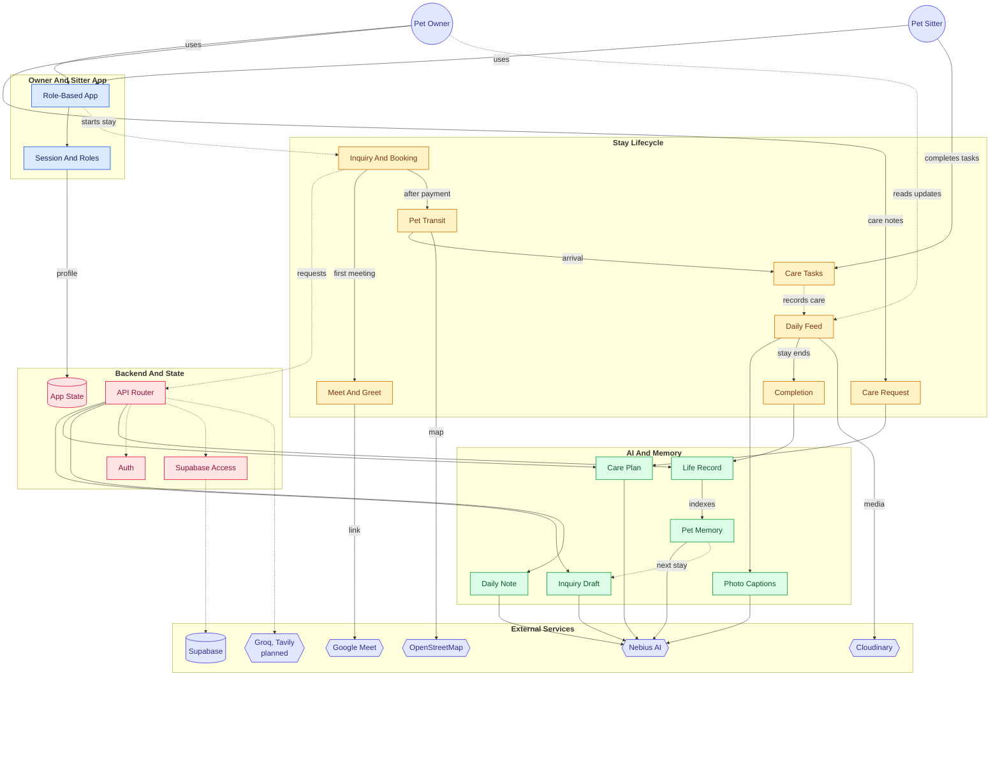

<div align="center">

<!-- TODO(logo): put the Goldito logo here, e.g.  — waiting for Muk's design. The Expo template icon in frontend/assets is only a placeholder; do not use it. -->

# Goldito

**Leave your pet, keep your peace of mind.**
The whole stay — inquiry to the ride home — in one app, for **dogs and cats**.
An AI agent answers, plans, checks, and writes, so the sitter can just care.

[](https://goldito-petcare.vercel.app)
[](docs/hackathon/README.md)
[](#how-we-use-nvidia-nemotron--nebius-token-factory)
[](LICENSE)
[](https://gitdiagram.com/minsikpaul92/goldito/video)
[](https://gitdiagram.com/minsikpaul92/goldito)

[Try it](#try-it-in-60-seconds) · [What changes](#what-changes) · [How it works](#how-goldito-works) · [Agent](#the-goldito-agent) · [Nemotron](#how-we-use-nvidia-nemotron--nebius-token-factory) · [Privacy](#privacy--safety-by-design) · [Run it](#run-it-yourself)

</div>

> **Why we built this.** After dozens of stays as pet sitters — many with the same dogs and cats — we kept seeing the same thing: apps connect owners and sitters, and take a cut of every booking, but the stay itself (replies, house rules, daily notes) is still typed by hand, and a lot of it happens outside the app.
>
> **Why AI.** In our experience, owners who find typing hard — often seniors — leave their pet's profile half empty, and sitters spend their time writing instead of caring. Goldito's AI does the typing; people approve.

---

## Try it in 60 seconds

> [!TIP]
> No setup: open **[goldito-petcare.vercel.app](https://goldito-petcare.vercel.app)** and tap **Try demo → Owner** (or **Sitter**). No sign-up and no password — the demo accounts and pets are fictional.

1. On a computer the app runs inside a phone frame: **click = tap, drag or scroll = swipe**. Sample photos are built in, so no camera is needed.
2. Open the other role in a private window to watch both sides of one stay.

> [!NOTE]
> The backend runs on a free plan: the first request after a quiet spell can take 30–50 s while it wakes up (we ping it every 10 minutes).

**Demo video:** _coming_

**One-minute tour** (auto-generated from this repo by [GitDiagram](https://gitdiagram.com/minsikpaul92/goldito/video) — not our submission video; click to watch on gitdiagram.com):

[](https://gitdiagram.com/minsikpaul92/goldito/video)

> [!NOTE]
> **Status legend** (as of 2026-10-11; refreshed at submission): ✅ works in the live demo · 🚧 being built before the deadline · 🔭 after the hackathon

---

## What changes

| For owners | For sitters |
| :--- | :--- |
| **Never need to ask.** Your pet's status — trip updates, photos, a daily note — arrives on its own, so you can relax. | **Just care, snap, and tap.** Replies, notes, and checklists are drafted for you; nothing in the house rules gets missed; you spend your time on the pet. |
| **A profile that gets filled in.** Photo, voice, and big one-question screens help even first-time and senior users describe their pet. 🚧 | **No more digging through old messages** for the medication time or the "don't knock" rule — it is on the checklist. |

## The five stages — and what the AI does in each

| Stage | What the AI does | Status |
| :--- | :--- | :--- |
| **① Inquiry** | Drafts the reply **in the sitter's own writing style**, from the sitter's calendar, a server-side quote, house policy, and the pet's Life Record | ✅ |
| **② Meet & Greet** | Turns the owner's care note into a timed **mission checklist** and Heads-up cards | ✅ · Google Meet link ✅ server, app check 🚧 · step bar + date hold ✅ |
| **③ Booking** | Stays out of the way on purpose: consents, prices, and the timed unlock come from fixed rules, never from the model | ✅ |
| **④ Care & Pet Transit** | Suggests the day's chips, writes the **daily note**, captions and sorts photos · live trip ✅ | ✅ care · ✅ transit |
| **⑤ Completion** | Writes the pet's **Life Record** and remembers it for the next stay — even with a new sitter | ✅ |

**More than sitting — reasons to stay in the app.** Between stays, Goldito keeps the pet's story: a photo **album**, a **diary** of every stay, a **Life Record** that follows the pet to any sitter, **favorite sitters**, two-way **reviews**, and live notifications ✅. Coming next: a **pet profile** built from a photo, your voice, and a few big-button questions 🚧, a **mood meter**, and an **8-bit pet room** 🔭.

---

## How Goldito works

```
 ① Inquiry ──> ② Meet & Greet ──> ③ Booking ──> ④ Care & Pet Transit ──> ⑤ Completion
 AI drafts in    care request       consents,      live trip · 5-second      home safe · review ·
 sitter's tone → checklist        payment,       check · AI daily note     Pet Life Record → RAG
                                   timed unlock                                       │
      ▲                                                                               │
      └──────────────── the next stay starts with everything Goldito learned ─────────┘
```

Full flow and every decision: [full-process.ko.md](docs/plan/full-process.ko.md).

Tap a stage to expand it.

<details>
<summary><b>① Inquiry — a reply in the sitter's own writing style ✅</b></summary>

- The owner picks **Boarding** (at the sitter's home) or **House sitting** (at the owner's home), the dates, and the pets — their profiles (breed, age, allergies) go with the question. With **Ask before booking**, nothing is booked until a request is sent. The sitter's profile also says whether she takes **one owner's pets at a time or several** (her setting) ✅.
- **Goldito AI drafts the reply in seconds** (about 3 s median), in the sitter's own style learned from their past conversations: availability from the sitter's calendar, a quote with **holiday** and **multi-pet** rates, answers from the house policy and the pet's **Life Record** (RAG). The sitter sends it with one tap — or opts in to auto-send, which answers at a human pace after a clear responsibility prompt — so a busy or sleeping sitter still answers first. The thread keeps going: the owner can write back, **change the dates in the same conversation**, and the sitter's Accept / Decline / Suggest other dates are drafted for them too.
- Prices and availability are calculated by the server, never by the model — "can she take these dates?" uses the same rule as the booking engine, and the reply and the checkout always show the same numbers.

</details>

<details>
<summary><b>② Meet & Greet — the care request becomes a checklist ✅</b></summary>

- The owner writes a **care & medication request** like a note: *"8 AM — 1 cup of kibble · 2 PM — skin pill in a treat · No knocking — text me · Keep other dogs away on walks."* Nemotron turns it into timed tasks and **Heads-up** cards, and the owner reviews it before saving. While a stay is on, changes go through a request the sitter approves.
- **First stay together? Meet first.** After the booking request, a first-time owner and sitter meet in person, at a spot either of them saved, or on video with a **Google Meet** link and calendar invite created the moment they agree on a time (server done, app check 🚧). Either side can ask to skip; if the other says no, the booking is cancelled and the owner finds another sitter. The sitter first says **Yes, let's meet** — from then on the dates are held for the owner — and if no meeting time is set within 2 days, both are asked to set one, skip it, or decline; with no answer the request is cancelled ✅. After meeting, either side can still say no ✅. Repeat clients skip this step.
- They choose how the pet travels: **Owner drives** or **Sitter drives**.

</details>

<details>
<summary><b>③ Booking — consents, payment, and secrets that unlock on time ✅</b></summary>

- **Consent forms** are generated for the chosen options, Canada-first: 24-hour emergency vet authorization, lockbox / buzzer / fob use, sharing space with other pets, and safe-return rules.
- **Payment** is simulated in the demo — no card needed.
- **Timed unlock:** for boarding, the sitter's address, visitor parking, and a packing list appear right after payment. Entry info for the owner's home (lockbox code, buzzer) **unlocks for the sitter only 2 hours before the visit**, and the owner is told when it opens.

</details>

<details>
<summary><b>④ Care & Pet Transit — 5-second checks, AI daily notes, live trips</b></summary>

- ✅ **5-second check:** Goldito suggests chips from the day's check-ins and photos — Meal ✅ · Potty ✅ · Walk 20 min ✅ · Meds ✅ · 🐿️ Squirrel at the park. The sitter turns off anything wrong and adds a short line if they want. **Nemotron writes the daily note** in the sitter's own voice from only those facts, and it is posted once the sitter approves it. Need another note the same day? Write another.
- ✅ **Timeline album:** every photo gets an AI caption and is sorted into Meals · Walks · Naps by day.
- ✅ **Uber-style transit:** whoever is driving taps **Start trip** (after a clear location prompt); the other side sees a live map and ETA, and on arrival the owner gets the sitter's place card (visitor parking, lobby notes) while the sitter gets the entry-info card. Both sides get **Open in Google Maps** — directions for the traveller, the place for the host. Anyone can also **start without sharing**: the other side then sees the meeting place instead of a map. On the web the traveller's screen has to stay on (browsers pause location in the background); the app after the hackathon shares in the background. A demo account can **simulate the drive**.
- 🔭 **Photo check-in:** one photo at the handoff, and a vision model confirms the pet is there and secured in the car (crate or seatbelt) — advice only, the sitter can continue. The check runs on the server; it is not in the app yet, because owner and sitter meet in person.
- 🚧 **Treat Safety Guard** *(stretch)*: scan a treat label; Nemotron Ultra and a curated toxic-ingredient table catch allergens and hidden sources (for example, chicken in "animal fat") before the treat is fed.

> *"Max took the skin pill you left, tucked inside her treat, and finished every bit of her kibble! On our 20-minute morning walk she spotted a squirrel in the park and got so excited — it was adorable. Her potty was perfectly healthy, too. 🐶"*
> — an AI daily note built from a few chips, two photos, and one short line from the sitter

</details>

<details>
<summary><b>⑤ Completion — home safe, and a record that remembers ✅</b></summary>

- The final handoff comes with a *"Max is home safe 🏠"* report, then a thank-you and a **5-star review** request. Sitters can also leave a private note about the owner that the owner never sees.
- Nemotron turns the whole stay — check-ins, tasks, daily notes — into the pet's **Life Record**: eating habits, potty patterns, medication response, behavior, and cautions.
- The Life Record goes into a **RAG knowledge base**. On the next booking, even with a **new sitter**, the AI reply, the checklist, and the sitter's request card already know the pet.

</details>

---

## The Goldito Agent

Goldito's AI works like an agent. Each event in a stay triggers it; it gathers the facts it needs, acts, and remembers. **A person approves anything that reaches the other side.**

| When this happens | The agent | A person decides |
| :--- | :--- | :--- |
| An owner asks about a stay | Checks the calendar, gets the server's quote, searches the pet's Life Record, and drafts a reply in the sitter's voice | The sitter taps **Send**, or turns on auto-send |
| The owner writes a care request | Turns it into timed tasks and Heads-up cards | The owner reviews and saves |
| A handoff photo is taken 🔭 | Checks that the pet is there and secured in the car | Advice only — the sitter can continue |
| The day ends | Suggests chips from check-ins and photos, then writes the daily note | The sitter fixes the chips, adds a line, and approves |
| The stay ends | Writes the pet's Life Record and indexes it for next time | The owner reads it |
| The next inquiry arrives | Retrieves that Life Record, so even a new sitter starts informed | — |
| A new owner registers a pet 🚧 | Reads a photo and a few spoken sentences, and suggests the profile — breed, coat, habits | The owner confirms every suggestion; safety answers are never pre-filled |

> [!IMPORTANT]
> Prices, dates, and entry codes never come from the model: the server supplies them, and the agent only writes around them.

---

## A Stay with Goldito (demo path)

Thanksgiving weekend, Oct 9–12: Robert leaves **Max** (dog, Maltese, allergic to chicken) and **Mochi** (cat) with sitter Chloe, whom he has never met. **System** means Goldito's AI and rules; a person approves everything the AI sends to the other side.

<details>
<summary><b>The stay, step by step</b> — 26 steps and 8 exceptions (click to expand)</summary>

| Flow | Actor | What happens |
| :--- | :--- | :--- |
| **Inquiry** | 1 · Owner | Asks Chloe about **Oct 9–12** — the dates, two pets, and the price — with **Ask before booking**. ✅ |
| | 2 · System | Checks Chloe's calendar with the booking engine's own rule, calculates the quote on the server (holiday and second-pet rates), searches Max's Life Record, and **drafts the reply in Chloe's own style**. With auto-send on, it goes out about 30 s later ("Chloe is typing…") while she sleeps; otherwise she taps **Send**. ✅ |
| | 3 · Owner | Reads the reply and the quote and taps **Request booking** — a request, not yet a booking. ✅ |
| **Meet & Greet** | 4 · Owner | Writes the care note — *"8 AM kibble · 2 PM pill in a treat · no knocking"* — by typing ✅ or, soon, by speaking 🚧. |
| | 5 · System | Nemotron turns the note into a timed **checklist** and **Heads-up** cards; the owner reviews and saves. ✅ |
| | 6 · Sitter | Opens the request: the checklist, the Heads-up cards, and the pet's profile (an "at a glance" card 🚧). Declines — or says **"Yes, let's meet"**, the first agreement. For a repeat client one **Accept** covers it and the Meet & Greet steps are skipped. ✅ |
| | 7 · System | Holds Chloe's dates for Robert so nobody else can book them, tells him she would like to meet, and shows both of them a **progress bar** — the current step and the one next action. ✅ |
| | 8 · Owner | Proposes a first meeting — **in person** at a public spot either of them saved (for example a park near Chloe's), or **on video** — with a date and time. ✅ |
| | 9 · Sitter | Accepts the time. For video, Goldito creates the **Google Meet** link and calendar invites. ✅ (link: server ✅, app check 🚧) |
| | 10 · Owner & Sitter | Meet — with the pets, if in person — and go through the "things to cover" list. One of them taps **Done**. ✅ |
| **Booking** | 11 · Sitter | After the meeting, taps **Confirm booking** — or declines with a reason chip. ✅ confirm · ✅ reason chips |
| | 12 · Owner | Reviews the final quote, signs the consent forms, and **pays (demo)**. A "Booked and paid" card says what happens next. ✅ Or taps **Not this sitter** with a reason chip, which releases the dates. ✅ |
| | 13 · System | Opens Chloe's address, visitor parking, and a packing list to the owner. ✅ |
| **Care & Pet Transit** | 14 · Owner | On drop-off day taps **Start trip** and agrees to share live location until arrival. Declining is fine — the meeting place still shows, with **Open in Google Maps**. ✅ |
| | 15 · System | Tells Chloe that Robert is on the way, shows the live map and ETA, and announces the arrival with the visitor-parking card. ✅ |
| | 16 · Sitter | Receives the pets at the meeting place and taps **Received**. The owner hears "care has started". ✅ |
| | 17 · Sitter | During the stay: sees the checklist and Heads-up cards, gets a reminder when a task is due, and taps to tick tasks (the pill, with a photo) and quick check-ins — meal, potty, walk, mood — plus photos. ✅ |
| | 18 · Owner | Sees every update live and the photos in the Feed — no need to ask. ✅ |
| | 19 · System → Sitter | Each evening, suggests chips from the day's records and photos. The sitter turns off any that are wrong and adds one short line; Nemotron writes the **daily note** in her voice; she approves it and it is posted. The album sorts itself into Meals · Walks · Naps. ✅ |
| | 20 · Owner | Reads the daily note. Reacting or asking a question — with an AI-drafted reply the sitter approves — comes later 🔭. |
| **Completion** | 21 · Owner | On pick-up day taps **Start trip** and shares location. ✅ |
| | 22 · Sitter | Sees the ETA, meets the owner at the agreed spot, and taps **Returned** after a confirm sheet (a warning if it is not yet pick-up time). ✅ |
| | 23 · System | Tells the owner *"Max and Mochi are home safe 🏠"* and asks for a review. ✅ |
| | 24 · Owner | Reviews the sitter (stars, preset phrases, own words) and can add her to favorites. ✅ |
| | 25 · System | Nemotron turns the stay into the pet's **Life Record** and indexes it, so the next sitter's request card, reply, and checklist already know the pets. ✅ |
| | 26 · Sitter | Leaves a **private note about the owner** — only she sees it, and it comes back when the same owner asks again. ✅ |

**Exceptions**

| When | What happens | Status |
| :--- | :--- | :--- |
| The sitter declines (at the request, or after meeting) | A reason chip and a suggested time; the owner can pick another sitter | ✅ reason chips |
| The owner decides against the sitter after meeting | **Not this sitter** with a reason chip; the dates are released | ✅ |
| Either side wants to skip the Meet & Greet | The other must agree — if not, the booking is cancelled and the owner finds another sitter | ✅ |
| No Meet & Greet time within 2 days | Both are asked to set one, skip it, or decline; after 3 more days of silence the request is cancelled and the dates are released | ✅ |
| No pet or crate in the handoff photo | Retake it, or continue with a reason (advice only) | 🔭 |
| The owner declines to share location | No live map — the meeting place is shown with **Open in Google Maps** | ✅ |
| The AI is unavailable | A plain-list draft instead of an error | ✅ |
| The sitter drives to the owner's home | The entry codes open only 2 hours before, and the owner is told when the sitter first opens them | ✅ |

</details>

Steps marked 🚧 are built last in the schedule; every other step runs in the live demo today.

---

## How We Use NVIDIA Nemotron & Nebius Token Factory

Every reasoning and writing call runs on **Nebius Token Factory** through its OpenAI-compatible API, from the backend only. NVIDIA Nemotron does the reasoning and writing; a Token Factory vision model reads photos; a Token Factory embedding model powers retrieval. Role → model IDs: [model-ids.md](docs/plan/phases/notes/model-ids.md).

| Stage | AI task | Model ID | Why |
| :--- | :--- | :--- | :--- |
| ① Inquiry | Inquiry auto-reply — a draft in the sitter's tone, grounded in the sitter's calendar, server-side quote, house policy, and the pet's Life Record. About 3 s (median) | `nvidia/NVIDIA-Nemotron-3-Nano-30B-A3B` + Qwen3 Embedding | Fast enough to answer in seconds; facts and prices come from the server, and every amount in the draft is checked against the quote |
| ① ⑤ Retrieval | Embeddings for the RAG knowledge base (Life Records, policies, past questions) | `Qwen/Qwen3-Embedding-8B` (1024-dim) | The embedding model on Token Factory; stored in Supabase pgvector |
| ② Meet & Greet | Care & medication request → structured mission checklist | `nvidia/nemotron-3-super-120b-a12b` | Reliable structure for times, doses, and cautions |
| ④ Transit 🔭 | Handoff photo check — pet visible, crate or seatbelt in the car (server API ready, not in the app yet) | `openbmb/MiniCPM-V-4_5` ¹ | Vision model on Token Factory |
| ④ Care | Photo descriptions → warm daily note from the 5-second check | `openbmb/MiniCPM-V-4_5` → `nvidia/nemotron-3-super-120b-a12b` | Few-shot tone from 3 years of (anonymized) real reports |
| ④ Album | Caption + category (Meals · Walks · Naps · Play) | `openbmb/MiniCPM-V-4_5` | One call per photo (about 1 s), no sitter typing |
| ④ Treat guard 🚧 *(stretch)* | Allergen & hidden-ingredient reasoning | `nvidia/Nemotron-3-Ultra-550b-a55b` | Safety-critical → strongest reasoning |
| ⑤ Completion | Stay → Pet Life Record (eating, potty, meds, behavior, cautions) | `nvidia/nemotron-3-super-120b-a12b` | Long-context summarizing that only uses recorded facts |
| New pet 🚧 | Spoken description → profile facts, each with the sentence it came from | `nvidia/NVIDIA-Nemotron-3-Nano-30B-A3B` | Server drops any value that has no matching quote |

<details>
<summary><b>Footnote, other services, and hosting</b> (click to expand)</summary>

¹ NVIDIA's vision models on Token Factory (`Nemotron-Nano-V2-12b`, `Cosmos3-Super-Reasoner`, `Nemotron-3-Nano-Omni`) are offered only as dedicated endpoints, not on the shared API (checked 2026-10-02), and keeping one running through judging would cost more than our credits — so vision uses MiniCPM-V-4.5 on the shared API. Reasoning, writing, and replies stay on Nemotron.

**Other services we use:** **Tavily** (web search for ingredients and recalls, and breed needs — 🚧), **Groq Whisper** for speech-to-text on the pet-profile voice step 🚧 (Token Factory has no speech model — checked 2026-10-10), **Cloudinary** (photos), **Supabase** (database, auth, realtime, pgvector), **Google Calendar / Meet**, **OpenStreetMap**.

**Hosting.** The web app is on **Vercel**; the FastAPI backend is on **Render** (Docker, free plan). Render's free plan sleeps after 15 minutes, so a GitHub Actions job and an external cron both ping `/health` every 10 minutes; a daily database ping keeps Supabase from pausing 🚧.

</details>

<!-- TODO(10.6, before submission): "Where Token Factory accelerated our workflow" + the per-model feedback table. Do not invent content. -->

---

## Privacy & Safety by Design

- **Entry info unlocks on time.** Lockbox and buzzer codes are readable only by the booked sitter, from 2 hours before the visit until the stay ends, and the owner is notified when they open. They never enter AI prompts or the RAG knowledge base.
- **Need-to-know access.** A sitter sees an owner's name and the pet asked about only for as long as the question or booking is live.
- **Location only while moving.** Trips share one live position, only with the other person on the booking, and stop when you arrive. No route history is stored. Declining is fine — the meeting place is still shown. ✅
- **The AI never invents facts.** Prices, dates, and availability come from the database; daily notes and Life Records use only what was recorded that day; a person approves every AI message that reaches the other side.
- **AI drafts can be wrong, and are not veterinary advice.** The pet profile (🚧) is the owner's description, **not a behavior assessment**.
- **No real personal data.** Demo accounts, pets, addresses, and codes are fictional; real messages used for tone are anonymized before they reach a prompt.

---

## Architecture

<details>
<summary><b>Architecture and stack</b></summary>

```
[ Owner app ]            [ Sitter app ]
      └──────────┬──────────┘
                 ▼
   Expo (React Native for Web / iOS / Android) — phone frame on desktop browsers
                 │  REST / JSON · Realtime (notifications, live threads)
                 ▼
        FastAPI (Python backend)
          ├── Supabase     → PostgreSQL + RLS · Auth · Realtime · pgvector (RAG)
          ├── Cloudinary   → photo/video storage, compression, thumbnails
          ├── Nebius Token Factory
          │     ├── Nemotron Nano   → inquiry auto-replies, profile facts from speech
          │     ├── Nemotron Super  → checklists, daily notes, Life Records
          │     ├── Nemotron Ultra  → treat safety reasoning (stretch)
          │     ├── MiniCPM-V       → captions, album sorting, daily-note photo chips
          │     └── Qwen3 Embedding → RAG retrieval
          ├── Google Calendar → Google Meet links + invites (video Meet & Greet)
          ├── OpenStreetMap → trip map (view only)
          ├── Tavily       → ingredient / recall / breed web search (stretch)
          └── Groq Whisper → speech-to-text for the pet-profile voice step (planned)
```

| Area | Stack |
| :--- | :--- |
| Frontend | Expo (React Native for Web) · **Vercel** |
| Backend | FastAPI (Python 3.12) · Docker · **Render** |
| Database / Auth / Realtime / Vector search | Supabase (PostgreSQL, RLS, pgvector) |
| Media | Cloudinary |
| AI | NVIDIA Nemotron + MiniCPM-V (vision) + Qwen3 Embedding on Nebius Token Factory · Groq Whisper (speech) |
| Maps | Leaflet + OpenStreetMap |
| Video Meet & Greet | Google Meet (via the Google Calendar API) |
| Web search | Tavily (stretch) |
| Notifications | Supabase Realtime in-app alerts (web demo) · Expo push notifications (native apps, after the hackathon) |

</details>

<details>
<summary><b>Architecture diagram — who talks to what</b> (click to expand)</summary>

Based on a [GitDiagram](https://gitdiagram.com/minsikpaul92/goldito) export, with Pet Transit, photo captions, OpenStreetMap, and the planned Groq / Tavily added. Dotted arrows are loops and planned parts.



</details>

---

## Run it yourself

The live demo above is the fastest way to see Goldito. To run your own copy you need a **Supabase** project, a **Nebius Token Factory** key, and a **Cloudinary** account (Tavily and Google OAuth are optional). Secrets setup: [env-setup.ko.md](docs/plan/env-setup.ko.md).

<details>
<summary><b>Setup steps and docs</b> (click to expand)</summary>

```bash
git clone https://github.com/minsikpaul92/Goldito.git && cd Goldito

# 1. Database — apply supabase/migrations/*.sql in order (see supabase/README.md)

# 2. Backend
cd backend && cp .env.example .env            # fill the keys
python3.12 -m venv .venv && source .venv/bin/activate
pip install -r requirements.txt
python -m scripts.seed_demo                    # creates the demo owner + sitter
uvicorn app.main:app --reload --port 8000

# 3. Frontend (new terminal)
cd frontend && cp .env.example .env            # EXPO_PUBLIC_API_URL=http://localhost:8000
npm install && npx expo start --web --port 8081
```

Open `http://localhost:8081` and use **Try demo**. Tests: `pytest -q` in `backend/`, Playwright in `frontend/` (see its README).

| Path | Doc |
| :--- | :--- |
| Backend env & run | [backend/README.md](backend/README.md) |
| Frontend env & run | [frontend/README.md](frontend/README.md) |
| DB migrations | [supabase/README.md](supabase/README.md) |
| Product flow · decisions · test guide | [full-process.ko.md](docs/plan/full-process.ko.md) · [architecture.ko.md](docs/plan/phases/architecture.ko.md) · [test-guide.ko.md](docs/plan/test-guide.ko.md) |

</details>

---

## What's Next

<details>
<summary><b>Roadmap — after the hackathon</b></summary>

- **Real payments** — Stripe checkout, refunds, and taxes in place of the demo payment.
- **Road-based ETA** — routing API, address search, and background location on native apps.
- **Drop-in visits** — short house visits with their own capacity rules.
- **Settings & patch notes** — in-app **What's New** from the [CHANGELOG](docs/CHANGELOG.md).
- **8-bit pet status room** — Tamagotchi-style Home dashboard: fed, potty, mood, next task.
- **Decorated daily notes** — pet cut-out stickers and AI-picked themes turn each note into a keepsake card.
- **Mood from video** — a short clip becomes a one-line mood note, based only on what the pet is visibly doing.
- **Pawstagram** and a **pet-friendly map** — a public feed for pet lovers, and cafés, stores, and parks that welcome pets.
- **Sitter desktop** — sitters plan schedules and send daily notes faster from a computer; owners stay on their phone.

</details>

---

## Resources

<details>
<summary><b>Docs and links</b> (click to expand)</summary>

- Product flow and decisions: [full-process.ko.md](docs/plan/full-process.ko.md) · [architecture.ko.md](docs/plan/phases/architecture.ko.md) · [test-guide.ko.md](docs/plan/test-guide.ko.md)
- Code: [backend](backend/README.md) · [frontend](frontend/README.md) · [database](supabase/README.md) · [development plan](docs/plan/README.md)
- [Hackathon rules](docs/hackathon/README.md) · [한국어 README](docs/README.ko.md)

</details>

---

## Team

| Member | Role |
| :--- | :--- |
| **Minsik** | Full-Stack Lead |
| **Seulgi** | AI & Prompt Engineer · Data Anonymization |
| **Muk** | Product & UX/UI Designer |

---

## License

[MIT](LICENSE)
