<div align="center">


# Goldito

**Leave your pet, keep your peace of mind.**

A pet-sitting app for dogs and cats where an **NVIDIA Nemotron** agent does the typing for the whole stay,<br>
the server owns every fact, and a person approves every word.

[](https://goldito-petcare.vercel.app)

[](docs/hackathon/README.md)
[](#powered-by-nvidia-nemotron-on-nebius-token-factory)
[](#powered-by-nvidia-nemotron-on-nebius-token-factory)
[](#tavily-live-answers-from-trusted-sites)
[](LICENSE)

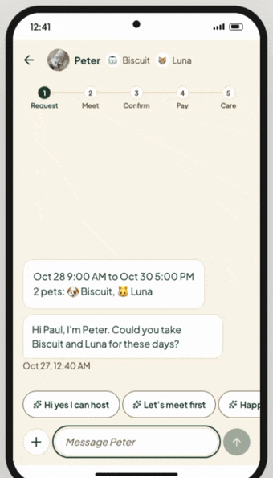

<sub><i>Booking chat: reply chips, Meet &amp; Greet, quote, and payment in one thread</i></sub>

**[Try the demo](https://goldito-petcare.vercel.app)** (no sign-up) · **[Watch the video](https://youtu.be/hjruk-XOlJE?si=uVOkhnTdrsbyxrQl)** · [Nemotron](#powered-by-nvidia-nemotron-on-nebius-token-factory) · [Tavily](#tavily-live-answers-from-trusted-sites) · [How it works](#how-goldito-works) · [Run it](#run-it-yourself)

</div>

> The backend runs on a free plan, so the first load after a quiet spell can take 30 to 50 seconds.

> **Judges:** tap **Try the demo**, then **Robert, the owner** or **Chloe, the sitter**, for a free Judge seat (Judge 1 to 4). A seat is yours alone: it starts from a clean stay and frees itself when you log out or leave for 10 minutes. On a computer, **[Show both phones](https://goldito-petcare.vercel.app/?view=split)** and use the panel left of the phones to run the five scenes. Demo accounts and pets are fictional.

---

## Contents

1. [Goldito in 30 seconds](#goldito-in-30-seconds)
2. [Powered by NVIDIA Nemotron on Nebius Token Factory](#powered-by-nvidia-nemotron-on-nebius-token-factory)
   - [The agent loop](#the-agent-loop)
   - [Models and measurements](#models-and-measurements)
3. [Where Token Factory accelerated our workflow](#where-token-factory-accelerated-our-workflow)
4. [Tavily: live answers from trusted sites](#tavily-live-answers-from-trusted-sites)
5. [How Goldito works](#how-goldito-works)
6. [Who it's for](#who-its-for)
7. [Architecture](#architecture)
8. [Privacy & Safety by Design](#privacy--safety-by-design)
9. [Run it yourself](#run-it-yourself)
10. [What's Next](#whats-next)
11. [Sources and Credits](#sources-and-credits)
12. [Team](#team)
13. [License](#license)

---

## Goldito in 30 seconds

**The insight.** *"The pet isn't anxious. The owner is."* That is Chloe, a pet sitter, and we have seen it for three years as sitters ourselves. With no news, owners text again, ask for a photo, and ask for it twice. Keeping owners in the loop takes us **at least 40 minutes a day**: the replies, the pill schedule, the evening update, the photos. Goldito cuts that to about **13 minutes** (our estimate), and sending an update becomes the fun part: a tap, a photo, a sticker.

**What Goldito does.** Goldito cares for the owner too. One chat per owner and sitter carries the whole stay: inquiry, Meet & Greet, booking, the trip, daily care, and the ride home. While the pet is in care, the sitter sends small care messages with a tap, so the owner hears from the sitter before they have to ask.

- **Updates before the owner asks.** Check-ins, photos, and the evening note reach the owner on their own. The sitter taps a chip and gets a reply in their own voice, taps a few check-ins and gets the note, snaps a photo and it is captioned and filed.
- **AI you can check.** Prices, dates, availability, and door codes come from the server, never from the model. Nemotron writes only from the facts it is handed, and **nothing is sent until a person taps Send**.
- **Memory that follows the pet.** Each stay becomes the pet's Life Record, so the next stay, even with a new sitter, starts already knowing the pet.

**AI is a tool here, not the sender.** Nothing goes out until a person taps Send. The server supplies the facts, the words sound like the sitter, and the memory follows the pet.

---

## Powered by NVIDIA Nemotron on Nebius Token Factory

Every AI call runs on **Nebius Token Factory**, from the backend only (keys never reach the app). **NVIDIA Nemotron 3** does the reasoning and writing: **Nano** for simple judgments, **Super** for anything that follows a conversation, **Ultra** for the safety call. A Token Factory vision model reads photos and an embedding model powers retrieval.

### The agent loop

```
 an event in the stay ──> the server gathers the facts ──> Nemotron writes ──> checks ──> a person ──> memory
 (a message, a care       (calendar, quote, policy,         from those       (numbers,   approves    (Life Record
  note, the evening,       pet profile, Life Record          facts only       rules,      or edits    → RAG for the
  a treat label)           via RAG)                                           quotes)                 next stay)
```

Each event in a stay triggers the agent. It answers only from the facts the server hands it, which is how we keep hallucination low.

| When this happens | The agent | Model | A person decides |
| :--- | :--- | :--- | :--- |
| A new owner registers a pet | Turns a photo and a few spoken sentences into profile suggestions and looks up breed needs | Nemotron 3.5 **Super VL** · Groq Whisper → Nemotron 3 **Nano** | The owner confirms every suggestion |
| A message arrives in the chat | Suggests reply chips and drafts a message in my voice, from the calendar, quote, policy, pet profile, and Life Record; points at the next step only if the code allows it | Nemotron 3 **Super** + Qwen3 Embedding | Taps a chip, edits, and taps **Send** |
| The sitter says yes | Recognizes it and brings up the Meet & Greet card | Nemotron 3 **Nano** | Either side requests, accepts, or skips |
| The owner writes a care request | Turns it into timed tasks and Heads-up cards | Nemotron 3 **Super** | The owner reviews and saves |
| The day ends | Suggests chips from check-ins and photos, then writes the daily note | Nemotron 3.5 **Super VL** → Nemotron 3 **Super** | The sitter fixes the chips and approves |
| A treat label is photographed | Reads it, applies the rule table, searches trusted sites (Tavily), and reasons about hidden sources | Nemotron 3.5 **Super VL** → Nemotron 3 **Ultra** | Danger needs an explicit "I understand" |
| The stay ends | Writes the pet's Life Record and indexes it | Nemotron 3 **Super** + Qwen3 Embedding | The owner reads it |

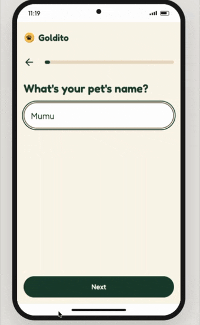

<sub><i>Sign-up: a photo and a few answers become your pet as an 8-bit character</i></sub>

**Guardrails.** The model never writes a price, a date, or an entry code (a draft whose numbers do not match the server is rewritten once, then falls back to plain words). Entry codes never enter a prompt or the RAG index. Life Records and spoken profile facts need recorded evidence or a matching quote, and safety answers are never pre-filled. The treat verdict is never below the rule table. If a model is slow or down, the screen shows fixed chips or a plain list, never an error.

### Models and measurements

| Model (Token Factory ID) | Used for | Measured |
| :--- | :--- | :--- |
| **Nemotron 3 Super** `nvidia/nemotron-3-super-120b-a12b` | Chat reply chips and drafts · care request → checklist · daily notes · Life Records | About 1 s per chip set or draft. In simulated 20-message chats, Nano drafts repeated themselves and fell back to bare chip words; Super did not, so the chat runs on Super |
| **Nemotron 3 Nano** `nvidia/NVIDIA-Nemotron-3-Nano-30B-A3B` | The sitter's "yes" · spoken profile → facts with quotes · sitter onboarding by voice · breed needs from search results · the mood line | Fast extraction where the server checks every value |
| **Nemotron 3 Ultra** `nvidia/Nemotron-3-Ultra-550b-a55b` | Treat check: allergens and hidden sources over the label, the rules, and Tavily excerpts | About 2.7 s with thinking on; the whole check about 7 to 8 s |
| **Nemotron 3.5 Super VL** `nvidia/Nemotron-3.5-Super-VL` ¹ | Treat labels · photo captions and album · daily-note photo chips · breed guess from a pet photo · mood tags · handoff photo check (server API, not in the app yet) | About 1 to 1.4 s per photo with thinking off. On six sample labels (5 variants, 60 calls) it missed no ingredient and said "incomplete" on every cut-off label |
| **Qwen3 Embedding 8B** `Qwen/Qwen3-Embedding-8B` | RAG over Life Records, sitter policies, and care requests · picking a sitter's own past replies as tone examples | `dimensions: 1024` fits a pgvector HNSW index |

¹ Its thinking is on by default and fills the token budget before any answer, so we switch it off per call. It is on the global Token Factory base URL only. NVIDIA's earlier vision models (`Nemotron-Nano-V2-12b`, `Cosmos3-Super-Reasoner`, `Nemotron-3-Nano-Omni`) are dedicated endpoints only (checked 2026-10-02). Measured on our demo photos: caption sorting 4 of 6, breed guess 10 of 12, six sample labels with no missed ingredient. Small samples and clean sample labels, not real packaging. Every check: [model-ids.md](docs/plan/phases/notes/model-ids.md).

**Tested in CI on every push:** about 690 pytest tests, more than 640 Playwright tests (68 specs, desktop phone frame and mouse), and 88 SQL migrations applied to a Postgres stub followed by a row-level-security smoke test.

---

## Where Token Factory accelerated our workflow

- **One API for everything.** Text, vision, and embeddings all go through the `openai` Python SDK pointed at Token Factory, in one client ([`services/nebius.py`](backend/app/services/nebius.py)). A feature asks for a role (`fast`, `report`, `safety`, `vision`), not a model.
- **Swapping a model is a config change.** Each role is an environment variable (`MODEL_FAST`, `MODEL_REPORT`, `MODEL_SAFETY`, `MODEL_VISION`, `MODEL_CHAT_*`). Moving the chat from Nano to Super after a side-by-side simulation, judged by Ultra, changed no code.
- **Checks before building.** `GET /v1/models` let us script what our key could really call: it showed early that there was no NVIDIA embedding model and no speech to text on the shared API, before we built on them.
- **Measured on the real API from day one.** The first Nano and vision calls ran with our first catalog check (2026-09-29); scripts in [`backend/scripts`](backend/scripts) time each feature. Every call writes one metrics line (endpoint, model, latency, time to first token, tokens), never the prompt or the answer.

**Other Nebius services.** We tried a Nebius AI Cloud Serverless endpoint for the FastAPI backend on 2026-10-09 and chose Render instead; why is in the feedback log below.

<details open>
<summary><h3>Feedback log: Token Factory, AI Cloud, and each model</h3></summary>

What we used, what worked, and what got in the way, written down as it happened. Details and numbers: [model-ids.md](docs/plan/phases/notes/model-ids.md) · [nebius-ai-cloud-feedback.md](docs/plan/phases/notes/nebius-ai-cloud-feedback.md).

**Nebius Token Factory**
- *Onboarding:* the catalog check and the first answers on the same day (2026-09-29): a Nano text call and a vision image call through the OpenAI SDK, with only the base URL and key changed.
- *Worked:* one OpenAI-compatible API for chat, vision, and embeddings; `GET /v1/models` for scripted checks; JSON mode and tool calling (`tools` + `tool_choice="auto"`) on Nano and Super, about 0.9 s per call; base64 data URLs as image input.
- *Got in the way:* NVIDIA's earlier vision models are dedicated-endpoint only (about $48 to $113 a day to keep one up); `Nemotron-3.5-Super-VL` is on the shared API, but its thinking is on by default and has to be turned off per call for short answers. No speech-to-text and no NVIDIA embedding model in the catalog. The two base URLs list different models (25 vs 18 on 2026-10-10). The catalog shows a "Fine-tuning" badge on Nemotron, but the model pages say fine-tuning is not available. External image URLs can fail, so we send data URLs.
- *Again?* Yes. We met NVIDIA models through this hackathon and Token Factory, and we plan to use both in our next projects. On list prices (public price trackers, 2026-10-27), Nemotron 3 Nano costs about 80% less on input and 90% less on output than Gemini 3.5 Flash-Lite, and Super's output costs about 64% less. We have not run the other models ourselves; in our own tests every Nemotron model met the bar we set for its job.

**NVIDIA Nemotron 3 Nano**
- *Worked:* fast enough for extraction in the flow of a screen; inquiry drafts over a 2k-token fact sheet took 3.2 s at the median (embedding included).
- *Got in the way:* with a small `max_tokens`, reasoning can fill the budget before any content (we use at least 64). In 20 and 50 message simulated chats its drafts repeated themselves, fell back to the chip's bare words, and made up details, so the chat moved to Super.
- *Again?* Yes. It met the quality, speed, and JSON reliability we needed for its job, at a price that suits a small product. We will keep Nemotron as our default for text.

**NVIDIA Nemotron 3 Super**
- *Worked:* the writing people read. In the same chat simulations it had no draft fallbacks, and about 1 s per chip set or draft. Reliable JSON for checklists and Life Records.
- *Got in the way:* in long chats it still invents small details (a park name, a litter brand), so numbers stay server-side and drafts are checked. Chips needed an explicit "under 30 characters, no digits" line.
- *Again?* Yes. It met the quality, speed, and JSON reliability we needed for its job, at a price that suits a small product. We will keep Nemotron as our default for text.

**NVIDIA Nemotron 3 Ultra**
- *Worked:* the treat check verdict in about 2.7 s with thinking on and JSON mode, 614 completion tokens, keeping both hidden sources in our test label. We also used it to rate whole simulated chats when choosing the chat model.
- *Again?* Yes. It met the quality, speed, and JSON reliability we needed for its job, at a price that suits a small product. We will keep Nemotron as our default for text.

**Nemotron 3.5 Super VL**
- *Worked:* it read all six sample labels with no missed ingredient across blur, small size, rotation, and cut-off versions, and said "incomplete" on every cut-off label; about 1 to 1.4 s per photo.
- *Got in the way:* thinking is on by default and fills `max_tokens` before any answer (we send `enable_thinking: false`); only on the global base URL, not the us-central1 one.
- *Again?* Yes. It worked well, it was fast, and we liked using it. It read our six sample labels without missing an ingredient, in about 1 to 1.4 s per photo, so a treat check or a photo caption feels instant on a phone. Once thinking was switched off it was easy to build on. We will keep it as our default for vision.

**Qwen3 Embedding 8B**
- *Worked:* `dimensions: 1024` on both base URLs, so it fits a pgvector HNSW index (2000 dimensions at most); 539 ms median per query embedding.
- *Again?* Yes. It worked well, it was fast, and we liked using it. `dimensions: 1024` fit our pgvector index without any extra work. We will keep it for retrieval.

**Nebius AI Cloud** (Serverless endpoint, tried and not used)
- *Worked:* a clear endpoint form with a live cost estimate; a public GHCR image needs no registry credentials; a whole `.env` can be mounted as a file.
- *Got in the way:* saving secret environment variables failed with a permission error and no hint on the missing role; no bulk env import; a $25 card top-up at Create while the event credit was not visible; the endpoint's Bearer token clashes with an app's own `Authorization` header; a 100 GiB minimum disk for a 300 MB image; no scale to zero, so staying up until judging ends would cost about $128 on the smallest CPU preset.
- *Again?* For GPU or model serving, yes: the form and the cost estimate are good. For a small always-on CPU API, the billing step and the secrets permission were the blockers.

</details>

---

## Tavily: live answers from trusted sites

**Why live search?** Hidden ingredients and recalls change, and no fixed list covers every brand. Our rule table is the floor (it can only make a verdict stricter); **Tavily** adds current pages and recalls, with sources the user can open. Goldito calls the Tavily Search API at runtime, **only on these trusted domains** (`include_domains`), never the open web:

| Feature | What Tavily searches | Trusted domains |
| :--- | :--- | :--- |
| **Treat check** (Snap tab) | The label's hidden sources, toxic or unknown ingredients, and recent recalls of the product. The excerpts go to Nemotron 3 Ultra; a link is shown only if the model relied on that page and the page names the product or a flagged ingredient, and none when the pet's own allergy already settles the verdict | [fda.gov](https://www.fda.gov) · [avma.org](https://www.avma.org) · [petpoisonhelpline.com](https://www.petpoisonhelpline.com) · [vcahospitals.com](https://vcahospitals.com) |
| **Breed needs** (sign-up, at a glance card) | One breed's care needs; Nemotron 3 Nano turns the result into short chips, each with its source | Dogs and cats: [vcahospitals.com](https://vcahospitals.com) · [merckvetmanual.com](https://www.merckvetmanual.com) |

- **Example:** the search `xylitol toxic dogs` returned pages from petpoisonhelpline.com, vcahospitals.com, and fda.gov in 2.9 s.
- **Fast and frugal:** basic depth (1 credit per search), every search in parallel under one 8-second budget. A search that fails or runs late is left out, and the check still answers from the label, the rules, and the model, and says that no sources were available.
- **Breed answers are cached:** a reviewed list of common breeds first, then a found result for 30 days, an empty one for 3 days.
- **Danger is loud:** a DANGER verdict opens a red screen that only "I understand" closes, and a sitter's DANGER also notifies the owner.
- Code: [`services/tavily.py`](backend/app/services/tavily.py) · [`services/breed_needs.py`](backend/app/services/breed_needs.py) · [`routers/ai_safety_check.py`](backend/app/routers/ai_safety_check.py)

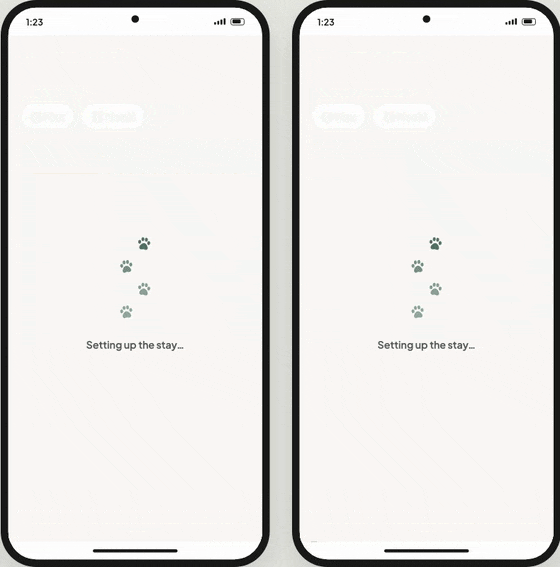

<sub><i>Treat check: chicken on the label gets a red DANGER</i></sub>

---

## How Goldito works

```
 ① Inquiry ──> ② Meet & Greet ──> ③ Booking ──> ④ Care & Pet Transit ──> ⑤ Completion
 one chat;       care request       agreement,     live trip · 5-second      home safe · reviews ·
 AI drafts in →  checklist ·      final quote,     check · AI daily note     Pet Life Record → RAG
 your voice      meet first       demo payment                                        │
      ▲                                                                               │
      └──────────────── the next stay starts with everything Goldito learned ─────────┘
```

| ① Inquiry | ② Meet & Greet | ③ Booking | ④ Care & Transit | ⑤ Completion |
| :---: | :---: | :---: | :---: | :---: |
| 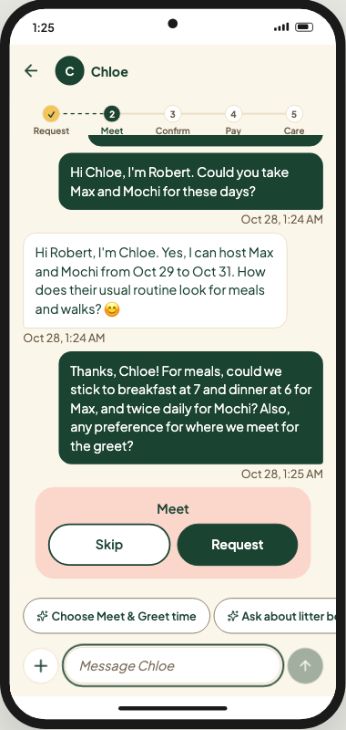 | 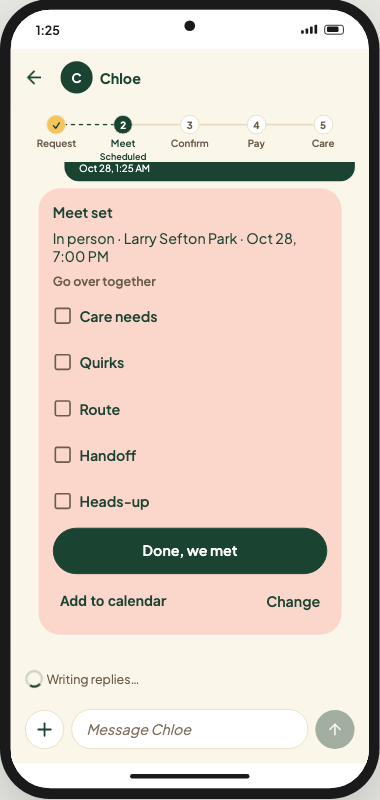 | 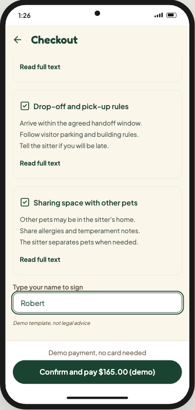 | 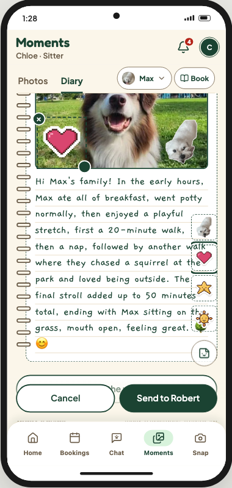 | 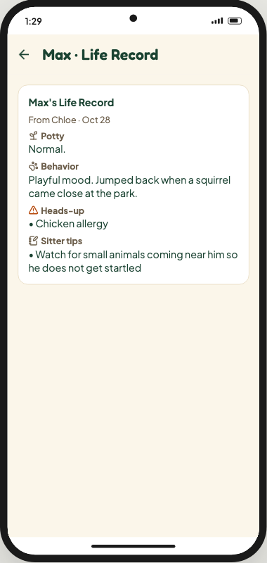 |

| Stage | What happens | What the AI does |
| :--- | :--- | :--- |
| **① Inquiry** | The owner finds a sitter and taps **Start chat**; one chat carries the whole stay | Reply chips and drafts in the sitter's own voice, grounded in server facts and the pet's Life Record |
| **② Meet & Greet** | First-time pairs meet in person or on Google Meet; the owner's care note becomes a checklist | Care note → timed tasks and Heads-up cards; notices the sitter's yes |
| **③ Booking** | Both agree, the sitter sends the final quote, the owner signs and pays (demo); door codes unlock 2 hours before the visit | Stays out of the way on purpose: quotes, consents, and unlocks are fixed rules |
| **④ Care & Pet Transit** | Live trip with ETA, tasks and check-ins, the 8-bit pet room, photo requests, the album | Photo chips, captions, and the daily note in the sitter's voice |
| **⑤ Completion** | Home safe, reviews both ways, a medal for each pet | The Life Record, indexed for the next stay |

Tap a stage for the details.

<details open>
<summary><b>① Inquiry: one chat per owner and sitter, with AI drafts in your own voice</b></summary>

- The owner searches sitters by dates, times, pets, and distance from home (1 to 100 km), opens a profile, and taps **Start chat**. The chat opens with a stay card (dates, times, pets) and a hello. That chat carries the whole stay: quote, Meet & Greet, agreement, payment, trips, photos, the daily note, and the reviews. The same owner and sitter always come back to the same chat.
- **The AI suggests, a person sends.** For the message the other side just wrote, Nemotron 3 Super offers two or three reply chips for *my* side. Tapping one drafts a short message in my voice (a sitter's voice is learned from their own anonymized past replies) that I can edit before I tap **Send**. When the next step is clear (send a quote, request a Meet & Greet, pay), the AI can point at one action chip, but only from the list of steps the code says are possible right now.
<p align="center"></p>

- **The model never writes a price or a date.** The sitter's calendar, rates, and quote (with **holiday** and **multi-pet** rates) come from the database. The facts also include the sitter's policy, the pet's profile and allergies, and the pet's **Life Record** (RAG on pgvector).

</details>

<details open>
<summary><b>② Meet & Greet: the care request becomes a checklist, and first-time pairs meet</b></summary>

- The owner writes a **care & medication request** like a note, or taps Quick add chips: *"8 AM: 1 cup of kibble · 2 PM: skin pill in a treat · No knocking, text me · Keep other dogs away on walks."* Nemotron 3 Super turns it into timed tasks and **Heads-up** cards; the owner reviews them before saving. While a stay is on, changes go through a request the sitter approves.
- When the sitter's own words say yes (Nemotron 3 Nano reads them), the chat brings up the **Meet & Greet** card and the dates are held for this owner. First-time pairs meet **in person** (Goldito suggests a park near the owner's home from OpenStreetMap) or **online**, where the backend creates a **Google Meet** link and calendar invite. Either side can ask to skip; both must agree. Repeat clients skip this step.
<p align="center"></p>

- No meeting time within 2 days? Both are asked to set one, skip it, or decline; after 3 more quiet days the request is cancelled and the dates are released.

</details>

<details open>
<summary><b>③ Booking: agreement, final quote, consents, payment, and secrets that unlock on time</b></summary>

- After meeting, the owner taps **I'd like to book** (with the checklist, pets, times, and price in view) and the sitter taps **I accept**, in either order. Either side can still say no, with a reason chip.
- The sitter sends the **final quote** with one tap; the server calculates it. The owner confirms it, signs the **consent forms** (Canada-first: 24-hour emergency vet authorization, lockbox / buzzer / fob use, sharing space with other pets, safe-return rules), and **pays (demo)**.
<p align="center"></p>

- **Timed unlock:** for boarding, the sitter's address, visitor parking, and a packing list appear right after payment. Entry info for the owner's home (lockbox code, buzzer) **unlocks for the sitter only 2 hours before the visit**, and the owner is told when it opens.

</details>

<details open>
<summary><b>④ Care & Pet Transit: live trips, the 8-bit pet room, 5-second checks, AI daily notes</b></summary>

**Uber-style trips, inside the chat.** Whoever drives taps **Start trip**, and the other side gets a live map and ETA.

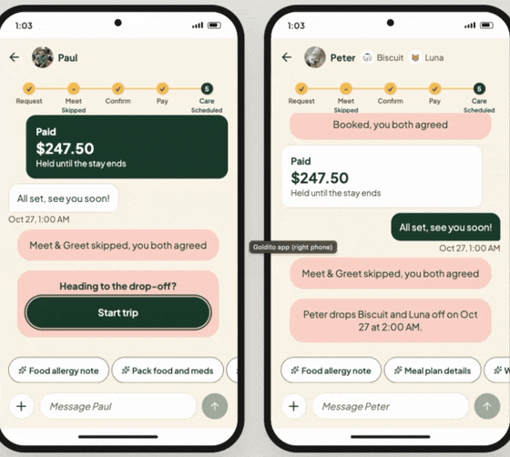

<sub><i>Live trip: the owner's map and ETA until the sitter arrives</i></sub>

**Care, snap, tap.** The sitter ticks tasks and taps meal, walk, potty, or nap on the pet's 8-bit room, and the owner sees each update live.

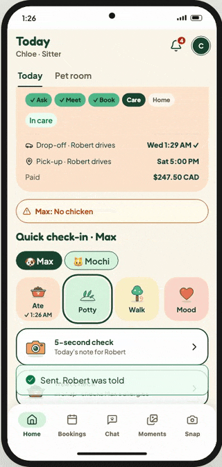

<sub><i>The 8-bit care room: the sitter taps Feed, Walk, Poop, or Nap</i></sub>

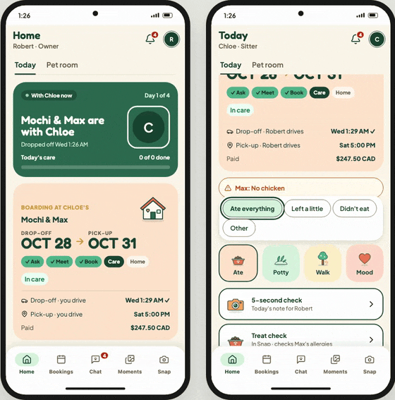

<sub><i>Check-ins and photos: the sitter taps, the owner's Home updates live</i></sub>

**5-second check.** In the evening Goldito suggests chips from the day's check-ins and photos, and Nemotron 3 Super writes the daily note in the sitter's voice once the sitter approves them.


> *"Max took the skin pill you left, tucked inside her treat, and finished every bit of her kibble! On our 20-minute morning walk she spotted a squirrel in the park and got so excited. It was adorable. Her potty was perfectly healthy, too. 🐶"*
> From an AI daily note built from a few chips, two photos, and one short line from the sitter

**Album and diary.** Every photo gets an AI caption, and the daily notes form a diary both sides can decorate with pet stickers.

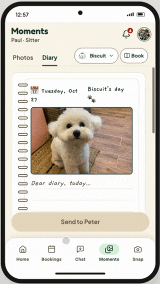

<sub><i>Diary: a page written from the day's chips and a photo, with stickers</i></sub>

</details>

<details open>
<summary><b>⑤ Completion: home safe, reviews both ways, and a record that remembers</b></summary>

- The final handoff comes with *"Max is home safe 🏠"*, then a **5-star review** request. The owner rates the sitter and can add them to favorites; the sitter reviews the owner (other sitters can read it) and gives each pet a medal.
<p align="center">
  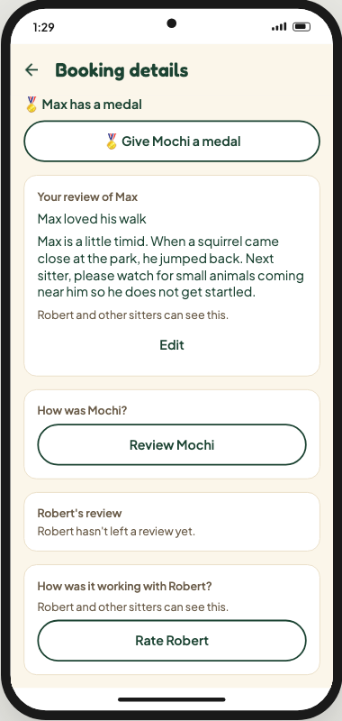
  
</p>

- Nemotron 3 Super turns the whole stay (check-ins, tasks, daily notes) into the pet's **Life Record**: eating habits, potty patterns, medication response, behavior, and cautions. Sentences with no recorded evidence are dropped.
- The Life Record goes into a **RAG knowledge base** (Qwen3 Embedding 8B, pgvector). On the next stay, even with a **new sitter**, the chat drafts, the checklist, and the sitter's request card already know the pet.

</details>

<details open>
<summary><b>Sign-up by photo and voice, and the 8-bit pet</b> (owners and sitters)</summary>

- One question per screen, with big buttons. A **pet photo** goes to Nemotron 3.5 Super VL, which reads up to three breed guesses and a coat color; the owner confirms them and adds the weight. Goldito then builds the **8-bit pet** from a library of breed presets: the breed picks the shape, the coat color paints it, and the weight sets the build. It lives on the owner's Home, and **Match colors from photo** can repaint it with the photo's own colors later.
- **Speak instead of typing:** the recording becomes text (Groq Whisper), the owner can fix it, and Nemotron 3 Nano pulls out profile facts, each with the sentence it came from. The server drops any value without a matching quote, and safety answers are never pre-filled. Sitters can answer their onboarding questions the same way.
- The pet gets an **at a glance** card (five traits, such as sociability and energy) and a **breed needs** line found with Tavily on trusted breed and vet sites.

</details>

<details open>
<summary><b>Snap tab: treat check, pet mood, stickers</b> (owners and sitters)</summary>

- **Treat check:** pick the pet, snap the label. Nemotron 3.5 Super VL reads the ingredients; a rule table checks the pet's allergens and species toxins; Tavily searches trusted vet and FDA pages; Nemotron 3 Ultra reasons about hidden sources (for example, chicken in "animal fat"). The answer is **SAFE · WARNING · DANGER** with sources, never below what the rule table says.
<p align="center">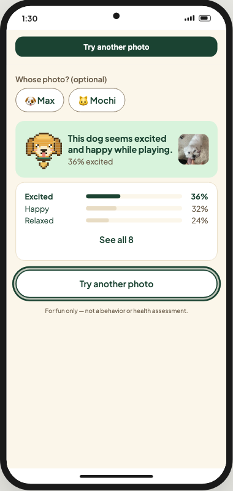</p>

- **Mood** *(for fun only)*: MediaPipe finds each pet in the browser, the vision model picks only visible body-language tags, and a fixed server rule table turns them into eight emotion percentages, so the same photo always gives the same numbers. Nemotron 3 Nano writes one "seems" line.
- **Sticker:** the pet is cut out in the browser (MediaPipe) into a transparent sticker with a white outline, ready to decorate a diary page.

</details>

---

## Who it's for

- **Independent pet sitters and the owners they care for, starting in Canada** (consent forms, holidays, and the quote follow Ontario first).
- **What a sitter gets back:** in our own work, the 40 minutes a day of messages, updates, reports, and schedule checks drop to about 13 minutes (our estimate).
- **What an owner gets:** peace of mind, since the owner is the one who worries, not the pet. Updates and alerts arrive without asking, so the owner always knows how the pet is doing now. The sitter keeps checking the care checklist and the allergy check.
<!-- TODO(Q8): what real owners and sitters said, once they have tried it. -->

---

## Architecture

| Layer | What we use |
| :--- | :--- |
| AI | **NVIDIA Nemotron 3** (Nano · Super · Ultra), Nemotron 3.5 Super VL, and Qwen3 Embedding 8B on **Nebius Token Factory** · **Tavily** search · Groq Whisper (speech to text; Token Factory has no speech model) |
| App | Expo (React Native for Web), one app for owners and sitters in a phone frame on desktop · MediaPipe in the browser · hosted on **Vercel** |
| Backend | FastAPI (Python 3.12), Docker on **Render**: AI endpoints, media signing, Google Meet links |
| Data | **Supabase**: Postgres with row-level security, Auth, Realtime (chat, notifications, live trips), pgvector for RAG |
| Media and maps | Cloudinary (photos and video) · Google Calendar / Meet · OpenStreetMap (address lookup, a park to meet at, trip map) |

```
[ Owner app ]            [ Sitter app ]
      └──────────┬──────────┘
                 ▼
   Expo (React Native for Web), phone frame on desktop · Vercel
   MediaPipe in the browser (pet finder, sticker cut-out)
                 │  REST / JSON · Supabase Realtime (chat, notifications, live trips)
                 ▼
        FastAPI (Python 3.12) · Docker on Render
          ├── Nebius Token Factory
          │     ├── Nemotron 3 Nano   → chat "yes", voice → profile facts, breed needs, mood line
          │     ├── Nemotron 3 Super  → chat chips and drafts, checklists, daily notes, Life Records
          │     ├── Nemotron 3 Ultra  → treat check reasoning
          │     ├── Nemotron 3.5 Super VL → labels, captions, album, photo chips, breed guess, mood tags
          │     └── Qwen3 Embedding   → RAG and tone examples
          ├── Tavily       → trusted vet, FDA, and breed pages
          ├── Groq Whisper → speech to text for voice sign-up
          ├── Supabase     → PostgreSQL + RLS · Auth · Realtime · pgvector
          ├── Cloudinary   → photo and video storage, compression, thumbnails
          ├── Google Calendar → Google Meet links and invites
          └── OpenStreetMap   → address lookup, a park to meet at, trip map tiles
```

<details open>
<summary><b>Architecture diagram: who talks to what</b></summary>

Dotted arrows are the memory loop and background calls.

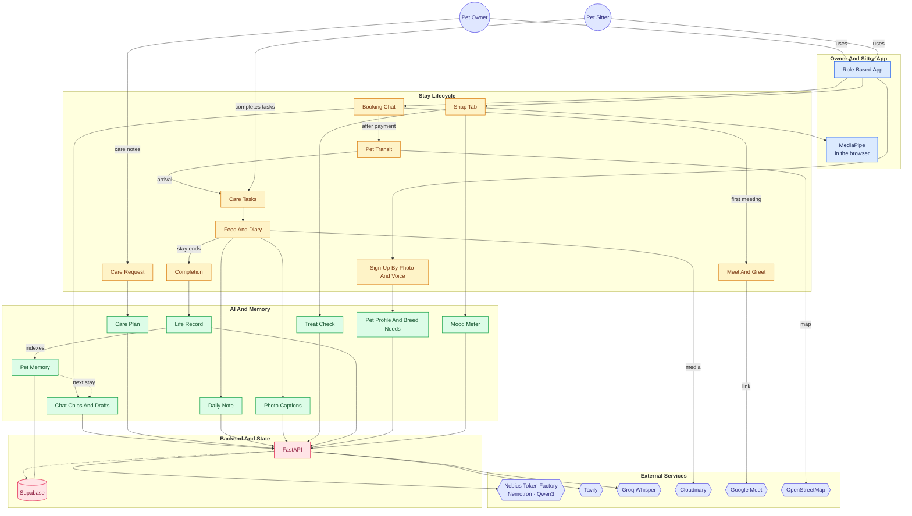

</details>

---

## Privacy & Safety by Design

- **The AI never presses Send.** Every chat message, daily note, and Life Record that reaches the other side is approved by a person.
- **Entry info unlocks on time.** Lockbox and buzzer codes are readable only by the booked sitter, from 2 hours before the visit until the stay ends, and the owner is notified when they open. They never enter AI prompts or the RAG index.
- **Need-to-know access.** Row-level security decides who sees a pet, a booking, or a photo; a sitter sees an owner's photos only when they share a chat or booking.
- **Location only while moving.** A trip shares one live position, only with the other person on the booking, and stops on arrival. No route history is stored.
- **AI output can be wrong, and is not veterinary advice.** The mood meter is for fun only, and the pet profile is the owner's description, not a behavior assessment.
- **No real personal data.** Demo accounts, pets, addresses, and codes are fictional; real messages used for tone are anonymized before they reach a prompt. The public demo caps AI calls and uploads per person per day.

---

## Run it yourself

The live demo is the fastest way to see Goldito. To run your own copy you need a **Supabase** project, a **Nebius Token Factory** key, and a **Cloudinary** account. **Tavily**, **Groq**, and **Google OAuth** keys are optional: without them the treat check answers without sources, voice sign-up is unavailable, and an online Meet & Greet gets no automatic Meet link.

<details open>
<summary><h3>Setup steps: run your own copy</h3></summary>

You need **Git**, **Python 3.12**, and **Node 20** or newer. Step 1 is the same on every OS; then pick yours.

**1. Code and database**

```bash
git clone https://github.com/minsikpaul92/Goldito.git
cd Goldito
```

Run every file in `supabase/migrations/` on your Supabase project, in name order (SQL Editor or psql; see [supabase/README.md](supabase/README.md)).

**Keys to fill in** (everything else in `.env.example` has a default or is optional; the model IDs are pre-filled)

| File | Keys | Where from |
| :--- | :--- | :--- |
| `backend/.env` | `SUPABASE_URL`, `SUPABASE_SERVICE_ROLE_KEY` | Supabase, Project Settings, API |
| | `CLOUDINARY_CLOUD_NAME`, `CLOUDINARY_API_KEY`, `CLOUDINARY_API_SECRET` | Cloudinary dashboard |
| | `NEBIUS_API_KEY` | Nebius Token Factory |
| | `DEMO_PASSWORD` | any value you choose |
| `frontend/.env` | `EXPO_PUBLIC_SUPABASE_URL`, `EXPO_PUBLIC_SUPABASE_ANON_KEY` | Supabase, Project Settings, API |
| | `EXPO_PUBLIC_CLOUDINARY_CLOUD_NAME` | Cloudinary dashboard |
| | `EXPO_PUBLIC_DEMO_PASSWORD` | the same value as the backend's `DEMO_PASSWORD` |

Details for each key: [docs/plan/env-setup.md](docs/plan/env-setup.md).

<details open>
<summary><b>macOS / Linux</b></summary>

```bash
# 2. Backend (fill backend/.env with the keys above)
cd backend
cp .env.example .env
python3.12 -m venv .venv
source .venv/bin/activate
pip install -r requirements.txt
python -m scripts.seed_demo        # creates the demo owners and sitters
uvicorn app.main:app --reload --port 8000
```

```bash
# 3. Frontend, in a new terminal from the repo root
# (fill frontend/.env with the keys above)
cd frontend
cp .env.example .env
npm install
npx expo start --web --port 8081
```

On Ubuntu or Debian, install `python3.12-venv` first.

</details>

<details open>
<summary><b>Windows (PowerShell)</b></summary>

```powershell
# 2. Backend (fill backend/.env with the keys above)
cd backend
Copy-Item .env.example .env
py -3.12 -m venv .venv
.venv\Scripts\Activate.ps1
pip install -r requirements.txt
python -m scripts.seed_demo        # creates the demo owners and sitters
uvicorn app.main:app --reload --port 8000
```

```powershell
# 3. Frontend, in a new terminal from the repo root
# (fill frontend/.env with the keys above)
cd frontend
Copy-Item .env.example .env
npm install
npx expo start --web --port 8081
```

If PowerShell blocks the activate script, run `Set-ExecutionPolicy -Scope CurrentUser RemoteSigned` once.

</details>

Open `http://localhost:8081` and use **Try the demo**. Tests: `pytest -q` in `backend/`, Playwright in `frontend/`.

| Path | Doc |
| :--- | :--- |
| Backend env, run, and demo seed | [backend/README.md](backend/README.md) |
| Frontend env and run | [frontend/README.md](frontend/README.md) |
| Database migrations and RLS smoke test | [supabase/README.md](supabase/README.md) |
| Where each key comes from | [docs/plan/env-setup.md](docs/plan/env-setup.md) |
| Design tokens and components | [DESIGN.md](DESIGN.md) |

</details>

---

## What's Next

- **Real payments:** Stripe checkout, refunds, and taxes in place of the demo payment.
- **iOS and Android apps:** background location on trips and push notifications.
- **The paid extras:** the AI subscription, 8-bit pet outfits, and diary sticker packs.
- **Handoff photo check in the app:** the vision check (pet visible, crate or seatbelt) already runs on the server.
- **Auto-send for sitters who opt in,** at a human pace, with a clear responsibility prompt.
- **Road-based ETA** with a routing API, and **drop-in visits** with their own capacity rules.
- **Pawstagram and a pet-friendly map:** a public feed for pet lovers, and cafés, stores, and parks that welcome pets.

---

## Sources and Credits

**Pet safety and breed information** (what the treat check and breed needs read)

| Source | Used for |
| :--- | :--- |
| [U.S. FDA](https://www.fda.gov) | Pet food recalls and ingredient safety, live search |
| [AVMA](https://www.avma.org) | Veterinary guidance, live search |
| [Pet Poison Helpline](https://www.petpoisonhelpline.com) | Toxins for dogs and cats, live search |
| [VCA Animal Hospitals](https://vcahospitals.com) | Toxins and breed care, live search and the reviewed breed list |
| [Merck Veterinary Manual](https://www.merckvetmanual.com) | Breed and care needs, live search |

Goldito reads short excerpts when it searches and does not store them. It keeps only ingredient names, its own short summary lines, and links, and shows the link with every answer. AI output is not veterinary advice.

**Maps and models:** map data © [OpenStreetMap](https://www.openstreetmap.org/copyright) contributors (address lookup through Nominatim) · [MediaPipe](https://ai.google.dev/edge/mediapipe) object detector (EfficientDet-Lite0) and interactive segmenter (Magic Touch), running in the browser.

**Design:** icons from [Lucide](https://lucide.dev) · fonts Fredoka and Plus Jakarta Sans from Google Fonts.

**Project docs:** [Hackathon rules and checklist](docs/hackathon/README.md) · [Project story](docs/hackathon/project-story.md) · [Model choices and measurements](docs/plan/phases/notes/model-ids.md) · [Changelog](docs/CHANGELOG.md)

---

## Team

| Member | Role |
| :--- | :--- |
| **[Minsik](https://github.com/minsikpaul92)** | Full-Stack Lead · AI Backend |
| **[Seulgi](https://github.com/seulgi-dev)** | AI & Prompt Engineer · QA · Data Anonymization |
| **[Mooque](https://github.com/mooque-dev)** | Product & UX/UI Designer |
| **[BeomGu](https://github.com/JeonBeomGu-S)** | Full-Stack Developer |

---

## License

[MIT](LICENSE)
